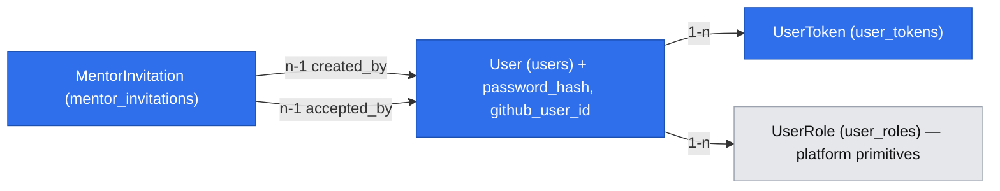

# E01 — Konto, logowanie i rola mentora

> Status: **zaakceptowana** (Natalia, 2026-10-18), **rewizja 4** (przegląd Gemini/GPT i grill-me, zob. „Revision log”); grill-me zakończony (G1–G11, 2026-10-18). Epik #11: story #17 (taski #18, #19) i #20. Wymaga `2026-10-18-platform-primitives.md` (etap A primitives przed etapem A tej specyfikacji, zob. Phasing).

## 📝 TLDR

Dziś DevMentor nie ma kont: nikt nie może się zalogować, a każda chroniona trasa odpowiada 401. Proponujemy (przyszłe zachowanie), żeby mentee i mentor zakładali konto e-mailem i hasłem albo przez GitHub (D13, R17) i od razu byli zalogowani. Adres e-mail trzeba potwierdzić dopiero przed pierwszą rezerwacją. Rolę mentora daje wyłącznie jednorazowy link zaproszenia od operatora, ważny 14 dni i możliwy do cofnięcia; zaproszony loguje się tak samo jak mentee (D18, R21). To początek ścieżki krytycznej: oferta mentora (E02), rezerwacja i płatność (E03) wymagają zalogowanego użytkownika z rolą.

## ⚠️ Open Questions

Q1–Q17 rozstrzygnięte 2026-10-18 (zob. „Decisions in play”). Brak pytań blokujących.

**Otwarte i nieblokujące (powiązane z Q09 z briefu — regulamin/RODO):** usunięcie konta i eksport danych osobowych oraz okres przechowywania i podstawa przetwarzania adresów **zaproszonych bez konta** (`mentor_invitations` trzyma adres bezterminowo, także po wygaśnięciu lub cofnięciu — G11). Poza 1.0, ale **nie „nigdy”**: wrócą razem z regulaminem, przed przyjmowaniem prawdziwych płatności. Model danych na to pozwala (`ON DELETE CASCADE` z `users` na tokeny i role; zaproszenia i konfiguracja wskazują operatora przez FK `SET NULL`).

## 📝 Problem Statement

- R17/D13: rezerwacja i płatność wymagają zalogowania. Koszt tej decyzji jest świadomy: dev z fintechu nie chciał zakładać konta, a booking dłuższy niż 5 minut kończy u niego „rollbackiem” (A05). Rejestracja ma więc **trzy pola** (Q13), konto działa od razu, a bramka weryfikacji e-maila stoi dopiero przed pierwszą rezerwacją (Q8).
- R21/D18: brak publicznej rejestracji mentora. Podaż to zaproszeni z listy (D09), więc każdy mentor wymaga akcji operatora, a operator potrzebuje konta (Q3: tworzy je skrypt CLI).
- D23: kontaktowalni są tylko zalogowani odwiedzający link mentora. Konto jest więc też warunkiem pomiaru (E05), nie tylko rezerwacji.

## 📝 Proposed Solution

Koncepcja `auth`, zbudowana na prymitywach (sesja, role, limiter, `MailGateway`):

1. **E-mail + hasło (#18).**
   - Rejestracja: e-mail, hasło, wyświetlana nazwa. Konto dostaje rolę `mentee` i ciasteczko sesji.
   - Logowanie zwraca ogólny błąd i ma limiter.
   - Weryfikacja e-maila: link z poczty, ponowna wysyłka z `/account`. Konto z **niepotwierdzonym** adresem może go zmienić (literówka przy rejestracji), co wysyła nowy link. Wymagana dopiero przed pierwszą rezerwacją (E03) i przed publikacją oferty mentora (E02, G7); `Session.emailVerified`, bramkę `requireVerifiedEmail` dodaje ten z E02/E03, który wejdzie pierwszy.
   - Reset hasła: link z poczty, ważny 1 h. Po resecie wszystkie stare sesje przestają działać.
   - Konto operatora zakłada wyłącznie skrypt CLI. Ten sam skrypt z `--reset-password` ustawia nowe hasło istniejącemu operatorowi (jedyna droga odzyskania bez działającej poczty).
2. **GitHub OAuth (#19).** Autoryzacja z `state` i PKCE. Konto rozpoznajemy w kolejności:
   - po `github_user_id`;
   - potem po **potwierdzonym** e-mailu z GitHuba (znormalizowanym jak przy rejestracji: `trim` + małe litery): łączenie, Q10a, **nigdy z kontem z rolą `operator`** (Q17: operator loguje się tylko hasłem z CLI);
   - na końcu tworzymy nowe konto z potwierdzonym e-mailem.

   Gdy GitHub nie potwierdza adresu, który ma już konto — odmowa z komunikatem. Bez skonfigurowanej aplikacji GitHub przycisk się nie pokazuje.
3. **Zaproszenie mentora (#20).** Operator tworzy zaproszenie dla e-maila. Link pokazuje się raz w panelu i trafia pocztą. Zalogowany użytkownik otwiera link i przyjmuje zaproszenie, co atomowo nadaje mu rolę `mentor`. Na jeden adres przypada najwyżej jedno aktywne zaproszenie: nowe cofa poprzednie. Operator widzi status, może cofnąć zaproszenie i odebrać rolę mentora (Q16).

**Odrzucone alternatywy:**
- **Weryfikacja e-maila od razu** (Q8: b zamiast c): dokłada czekania tam, gdzie A05 mierzy porzucenia.
- **Allowlista e-maili** dla mentorów (Q11: a, nie b): nadaje rolę bez świadomej akcji zaproszonego i wymaga zgodności adresu, co psuje logowanie GitHubem z innym adresem.
- **Przekazywanie tokenu zaproszenia przez OAuth `state`:** przyjęcie zaproszenia jest osobnym krokiem po zalogowaniu (`/invite#token=…` → token odłożony w `sessionStorage` → logowanie z `next=/invite` → powrót → „Przyjmij”). Dzięki temu działa tak samo przy haśle i GitHubie i nie komplikuje callbacku.
- **Biblioteka OAuth** (`arctic`, Auth.js): przepływ jednego dostawcy to ~80 linii za portem `GithubOAuthGateway`, a port i tak jest potrzebny do testów (`AGENTS.md`: bez zależności na 20 linii kodu; tu granica jest bliska, ale port wygrywa testowalnością).

## 📝 Research — czego uczą liderzy

- **Łączenie kont (Auth.js, Better Auth):** obaj łączą po e-mailu tylko przy potwierdzonym adresie, jak Q10a. Better Auth dodatkowo chroni przed **pre-account takeover**: napastnik zakłada konto z hasłem na cudzy adres, a ofiara loguje się później GitHubem. Przejmujemy tę ochronę: przy łączeniu z kontem o **niepotwierdzonym** e-mailu usuwamy `password_hash`, wszystkie wiersze `user_tokens` tego konta i podbijamy `session_version`, więc hasło napastnika, jego sesje i wysłane mu linki (np. reset) przestają działać.
- **OWASP Forgot Password:** jednakowa odpowiedź „jeśli konto istnieje…”, token jednorazowy, krótki i hashowany, unieważnienie sesji po zmianie hasła. Wszystko to bierzemy.
- **OWASP Authentication / NIST 800-63B:** długość hasła zamiast reguł złożoności, bez wymuszonej rotacji, porównanie ze stałym kosztem dla nieistniejącego konta (atrapa hasha bcrypt), żeby czas odpowiedzi nie zdradzał istnienia konta.
- **Codementor, MentorCruise, Topmate:** logowanie przez Google/GitHub i e-mail, bez weryfikacji przed pierwszą akcją przeglądania. Spójne z Q8.
- **Czego nie bierzemy:** MFA, magic linków, Google/LinkedIn, zmiany **potwierdzonego** e-maila, wylogowania wszędzie na żądanie (Q14) ani usunięcia konta (otwarte, Q09).

## 📝 Architecture

| Element | Plik |
|---|---|
| `AccountService`: `register`, `login`, `me`, `verifyEmail`, `resendVerification`, `requestPasswordReset`, `resetPassword`, `changeUnverifiedEmail`, `changeDisplayName`, `createOperator`, `resetOperatorPassword` | `core/src/services/auth/account.service.ts` |
| `GithubLoginService`: rozpoznanie i łączenie konta, reguły Q10 | `core/src/services/auth/github-login.service.ts` |
| `InvitationService`: `create`, `list`, `revoke`, `accept`, `removeMentorRole` (Q16) | `core/src/services/auth/invitation.service.ts` |
| `UserTokenService`: generuje 32 losowe bajty jako `base64url`; w bazie SHA-256; wydanie nowego tokenu = upsert po (`user_id`, `purpose`); zużycie = `DELETE … RETURNING` | `core/src/services/auth/user-token.service.ts` |
| `PasswordHasher` (`bcryptjs`, koszt `BCRYPT_COST = 12` z `AGENTS.md`; atrapa hasha dla nieistniejących kont) | `core/src/services/auth/password-hasher.service.ts`, singleton |
| `GithubOAuthGateway` (port) + adapter HTTP | `core/src/services/auth/github-oauth.port.ts`, `core/src/services/auth/adapters/github-oauth.adapter.ts` |
| Treść e-maili (weryfikacja, reset, zaproszenie) | `core/src/services/auth/auth-mail.ts` |
| Walidatory | `core/src/validators/auth/{register,login,password-reset-request,password-reset-confirm,token-confirm,invitation-create,display-name-update,email-change}.schema.ts` |
| Trasy | `app/app/api/auth/**/route.ts` (tabela w API Contracts) |
| Strony | `(auth)`: `/login`, `/register`, `/forgot-password`, `/reset-password`, `/verify-email`, `/invite`, `/account`; `(mentor)`: `/mentor`; `(operator)`: `/admin/invitations` (osobnej listy użytkowników nie ma; kto jest mentorem, widać w kolumnie „przyjęte przez”) |
| Skrypt CLI | `scripts/create-operator.ts` uruchamiany przez `tsx` (`npm run operator:create`, `npm run operator:create -- --reset-password`); woła `withScope((c) => c.accountService.createOperator(…))` / `resetOperatorPassword(…)` — bez `pg`, bez SQL |

`GithubOAuthGateway`: `authorizeUrl(state, codeChallenge)`, `exchangeCode(code, verifier)`, `fetchProfile(accessToken)` → `{ githubUserId, login, name, emails: { email, primary, verified }[] }`. Adapter używa `fetch` w `core` (reguła ESLint o `fetch` dotyczy `app` i `ui`). Adresy GitHuba (`GITHUB_OAUTH_BASE_URL`, `GITHUB_API_BASE_URL`) mają domyślne wartości produkcyjne, a w testach integracyjnych wskazują lokalny stub.

**Tokeny w linkach — fragment URL, nie query string.** Linki z e-maili i z panelu operatora mają postać `/verify-email#token=…`, `/reset-password#token=…`, `/invite#token=…`. Fragment nie trafia do serwera, więc nie ląduje w logach Next ani reverse proxy, ani w nagłówku `Referer`. Strona (komponent kliencki) czyta `location.hash`, od razu czyści go `history.replaceState` i wysyła token POST-em przez `apiCall`. `/invite` dla niezalogowanego odkłada token w `sessionStorage` i przekierowuje do logowania z `next=/invite` — **token nigdy nie wchodzi do `next`**, bo `next` jest w query stringu `/login`. Strony `(auth)` mają nagłówek `Referrer-Policy: no-referrer` (`headers()` w `next.config.ts` dla ścieżek grupy). Callback OAuth musi mieć `code` i `state` w query (wymóg GitHuba): logi aplikacji zapisują tylko `pathname` (tak już robi `apiHandler`, tak samo `redirectHandler` z primitives), a `url`, `*.url`, `req.url` trafiają do `LOG_REDACT_PATHS`. `code` jest jednorazowy i związany z PKCE, więc wyciek z logów serwera poza naszą kontrolą jest mało wartościowy.

**Przekierowania OAuth i parametr `next`:** start i callback OAuth zwracają 302, więc używają `redirectHandler()` z platform primitives (nie `apiHandler`). Powrót po logowaniu zawsze przechodzi przez `safeNextPath()` z primitives — na stronach `(auth)` i w callbacku.

## 📝 Data Model

Rozszerza tabele z platform primitives (migracje E01 są osobne).

**`users`** — nowe kolumny:

| Kolumna | Typ | Uwagi |
|---|---|---|
| `password_hash` | `varchar(60)` NULL | `NULL` dla kont tylko z GitHuba i po usunięciu hasła przy łączeniu |
| `github_user_id` | `bigint` NULL **UNIQUE** | stabilne id GitHuba (nie login, bo login można zmienić) |

**`user_tokens`**:

| Kolumna | Typ | Uwagi |
|---|---|---|
| `user_id` | FK → `users.id` ON DELETE CASCADE | |
| `purpose` | enum `email_verification` \| `password_reset` | |
| `token_hash` | `char(64)` NOT NULL **UNIQUE** | SHA-256 hex; surowy token nigdy w bazie ani w logach |
| `expires_at` | `timestamptz` NOT NULL | `EMAIL_VERIFICATION_TTL = 24 h`, `PASSWORD_RESET_TTL = 1 h` (OWASP: krótko) |
| | **UNIQUE (`user_id`, `purpose`)** | najwyżej jeden żywy token danego celu na konto |

Bez kolumny `used_at` — zużyty token znika.

- **Wydanie nowego tokenu** (działa tylko ostatni link): jedno polecenie `INSERT … ON CONFLICT (user_id, purpose) DO UPDATE SET token_hash = excluded.token_hash, expires_at = excluded.expires_at` (upsert MikroORM / QueryBuilder). Unieważnienie starego i utworzenie nowego dzieją się atomowo, a konflikt na UNIQUE blokuje wiersz (`user_id`, `purpose`), więc dwa równoczesne wydania nie zostawią dwóch żywych tokenów — ostatni zapis wygrywa, a link z przegranego żądania jest nieważny. To jest wymagana „transakcja z blokadą per (`user_id`, `purpose`)”, wyrażona constraintem zamiast ręcznego `SELECT … FOR UPDATE`.
- **Zużycie:** `DELETE FROM user_tokens WHERE token_hash = ? AND purpose = ? AND expires_at > now() RETURNING user_id` przez QueryBuilder — atomowo, bez check-then-write; dwa równoczesne kliknięcia: dokładnie jedno dostaje `user_id`.
- Wygasłe wiersze zostają do następnego upsertu tego celu albo do usunięcia konta (najwyżej dwa na konto — bez zadania sprzątającego).
- Potwierdzenie e-maila, reset hasła i łączenie z GitHubem (pre-account takeover) usuwają **wszystkie** tokeny konta.

**`mentor_invitations`**:

| Kolumna | Typ | Uwagi |
|---|---|---|
| `email` | `varchar(254)` NOT NULL | adresat (znormalizowany) |
| `token_hash` | `char(64)` NOT NULL **UNIQUE** | |
| `expires_at` | `timestamptz` NOT NULL | `MENTOR_INVITATION_TTL = 14 dni` (Q11) |
| `created_by_id` | FK → `users.id` ON DELETE SET NULL | operator |
| `revoked_at` | `timestamptz` NULL | |
| `accepted_at` | `timestamptz` NULL | |
| `accepted_by_id` | FK → `users.id` ON DELETE SET NULL | kto przyjął (Q15: może mieć inny e-mail) |

| | **częściowy UNIQUE (`email`) WHERE `accepted_at IS NULL AND revoked_at IS NULL`** | najwyżej jedno nieprzyjęte, niecofnięte zaproszenie na adres (indeks w migracji przez `addSql` ze stałym SQL) |

Status liczymy, nie przechowujemy: `accepted` > `revoked` > `expired` > `pending`.

**Utworzenie zaproszenia** (jedna transakcja): `UPDATE mentor_invitations SET revoked_at = now() WHERE email = ? AND accepted_at IS NULL AND revoked_at IS NULL` (cofa poprzednie aktywne i wygasłe-nieprzyjęte), potem `INSERT`. Wyścig dwóch równoczesnych utworzeń kończy się na częściowym UNIQUE: drugie dostaje 409 „Zaproszenie dla tego adresu właśnie powstało — odśwież listę”.

**Przyjęcie zaproszenia** (jedna transakcja):
1. `UPDATE mentor_invitations SET accepted_at = now(), accepted_by_id = ? WHERE token_hash = ? AND accepted_at IS NULL AND revoked_at IS NULL AND expires_at > now() RETURNING id`. Brak wiersza → „Zaproszenie jest nieważne”.
2. `INSERT user_roles (mentor) ON CONFLICT (user_id, role) DO NOTHING`. Gdy konto już ma rolę mentora — zaproszenie **i tak zostaje przyjęte** (token zużyty, link martwy), odpowiedź 200 z `alreadyMentor: true` i komunikatem „Masz już rolę mentora”.

Dwie równoczesne próby z jednym tokenem: wygrywa dokładnie jedna (blokada wiersza przy `UPDATE`).

**Stałe** (`db/src/constants.ts`, współdzielone z walidatorami):
- `PASSWORD_MIN_LENGTH = 12`: kompromis między A05 (krótka rejestracja) a NIST 800-63B-4 (15 dla haseł jako jedynego składnika), potwierdzony w grill-me (G5). Do przeglądu razem z A05.
- `PASSWORD_MAX_BYTES = 72`: bcrypt ignoruje dalsze bajty, więc walidujemy długość w bajtach UTF-8, nie w znakach.

**Odrzucane hasła (G5)** — sprawdzane **tylko na serwerze**, w `core/src/services/auth/password-policy.ts`, nie w schemie Zod (walidatory trafiają do przeglądarki i mogą importować tylko `zod` i `@devmentor/db/constants`):
- hasło z listy ok. 10 tys. najczęstszych haseł — lokalny plik tekstowy w `core/src/services/auth/common-passwords.txt`, porównanie bez rozróżniania wielkości liter, bez zapytań sieciowych; źródło listy z licencją pozwalającą na włączenie do repo (np. SecLists, MIT) — licencję sprawdzić i wpisać w nagłówek pliku;
- hasło równe adresowi e-mail konta (po normalizacji obu).

Ta sama polityka obowiązuje przy rejestracji, resecie hasła i w CLI operatora (także `--reset-password`). Błąd wraca jako `ValidationError` z `fieldErrors.password` = „To hasło jest zbyt popularne lub łatwe do odgadnięcia”, więc `CrudForm` pokazuje go przy polu (po wysłaniu, nie w trakcie pisania).

**Migracje:** `auth-credentials` (`password_hash`, `user_tokens`) w fazie 1, `auth-github` (`github_user_id`) w fazie 2, `auth-mentor-invitations` w fazie 3. Każda faza dostarcza tylko swój schemat.

**Dane wrażliwe:**
- Hash hasła i hash tokenów nie wychodzą poza serwis: DTO mają jawną listę pól, wzorem `TechnologyDto`.
- Do `LOG_REDACT_PATHS` dopisujemy `passwordHash` (już jest), `tokenHash`, `*.tokenHash`, `code`, `*.code`, `state`, `*.state`, `codeVerifier`, `clientSecret`, `*.clientSecret`, `url`, `*.url` (adresy z query stringiem callbacku OAuth).
- Surowe tokeny istnieją tylko we fragmencie linku (poczta / jednorazowy widok operatora), w `sessionStorage` na czas logowania przy zaproszeniu i w body POST-a.

`User` i `UserRole` powstają w platform primitives (na diagramie `User` jest „nowa”, bo E01 dodaje do niej kolumny). Przyjęcie zaproszenia tworzy wiersz `UserRole` z `granted_by_id` = `created_by_id` zaproszenia.

## 📝 API Contracts

Koperta `{ ok, data }`. CSRF (`x-devmentor-request`) na wszystkich metodach zmieniających stan, również na logowaniu i rejestracji. Odpowiedzi z kontem zwracają `AccountDto = { id, email, displayName, roles, emailVerified, hasPassword, githubLinked }`.

| Metoda i trasa | Dostęp | Wejście | Sukces | Błędy |
|---|---|---|---|---|
| `POST /api/auth/register` | publiczny | `{ email, password, displayName }` | 201 `AccountDto` + ciasteczko sesji; e-mail weryfikacyjny | 400 `fieldErrors`; 409 przy polu `email` „Ten e-mail ma już konto” (constraint, nie zapytanie wcześniej); 429 |
| `POST /api/auth/login` | publiczny | `{ email, password }` | 200 `AccountDto` + ciasteczko | 401 „Nieprawidłowy e-mail lub hasło” — **ten sam** dla nieznanego e-maila, złego hasła i konta bez hasła; 429 |
| `POST /api/auth/logout` | publiczny (idempotentny) | — | 200 + wyczyszczone ciasteczko | — |
| `GET /api/auth/me` | sesja | — | 200 `AccountDto` | 401 |
| `PUT /api/auth/display-name` | sesja | `{ displayName }` (ta sama reguła co przy rejestracji, `DISPLAY_NAME_MAX_LENGTH`) | 200 `AccountDto` | 400 `fieldErrors` |
| `PUT /api/auth/email` | sesja | `{ email }` | 200 `AccountDto`; nowy adres, stare tokeny weryfikacji usunięte, nowy link wysłany | 400; 409 przy polu `email` „Ten e-mail ma już konto”; 409 „Adres jest już potwierdzony — zmiana niedostępna” (Q14); 429 |
| `POST /api/auth/email-verification/resend` | sesja | — | 200 (też gdy już potwierdzony: nic nie wysyła) | 429 |
| `POST /api/auth/email-verification/confirm` | publiczny | `{ token }` | 200 `{ emailVerified: true }` | 400 „Link jest nieważny lub wygasł” (jeden komunikat dla każdej przyczyny); 429 |
| `POST /api/auth/password-reset/request` | publiczny | `{ email }` | 200 **zawsze** „Jeśli konto istnieje, wysłaliśmy link” | 400 (zły format); 429 |
| `POST /api/auth/password-reset/confirm` | publiczny | `{ token, password }` | 200; hasło zmienione, `session_version` + 1, e-mail oznaczony jako potwierdzony (posiadanie skrzynki to dowód); bez automatycznego logowania | 400 jak wyżej; 429 |
| `GET /api/auth/github/start?next=` | publiczny | — | 302 do GitHuba; ciasteczko `devmentor_oauth` (`httpOnly`, `sameSite=lax`, 10 min) z `state`, `codeVerifier`, `next` | 302 `/login?error=github_unavailable`, gdy brak konfiguracji |
| `GET /api/auth/github/callback?code&state` | publiczny | — | 302 do `next` + ciasteczko sesji; ciasteczko OAuth usunięte | 302 `/login?error=` `github_denied` (odmowa w GitHubie — **konto nie powstaje**), `github_state` (zły/brak `state`), `github_no_verified_email`, `github_email_unverified` (Q10: adres istnieje, GitHub go nie potwierdza), `github_operator_account` (Q17); 429 |
| `GET /api/auth/invitations` | `operator` | — | lista `{ id, email, status, createdAt, expiresAt, acceptedBy?: { id, displayName, email } }` | 403 |
| `POST /api/auth/invitations` | `operator` | `{ email }` | 201 `{ invitation, link, revokedPrevious }` — `link` **tylko w tej odpowiedzi**; poprzednie aktywne zaproszenie na ten adres cofnięte; e-mail z linkiem | 400; 403; 409 przy wyścigu (zob. Data Model) |
| `DELETE /api/auth/invitations?id=` | `operator` | — | 200; cofa tylko `pending` | 404; 409 „Zaproszenie zostało już przyjęte” |
| `POST /api/auth/invitations/accept` | sesja (nie `operator`, Q17) | `{ token }` | 200 `{ account: AccountDto, alreadyMentor }` — także gdy konto już było mentorem (zaproszenie zużyte) | 400 „Zaproszenie jest nieważne”; 403 dla konta operatora; 429 |
| `DELETE /api/auth/mentor-roles?userId=` (Q16) | `operator` | — | 200 | 404, gdy brak roli |

**Reguła z `AGENTS.md`:** trasy zaproszeń operatora pisane bezpośrednio na `apiHandler`, bo `create` zwraca jednorazowy link spoza DTO, a `DELETE` to cofnięcie, nie usunięcie. Jeśli `makeCrudRoute` da się użyć bez `PUT` i z własnym kształtem odpowiedzi `create`, implementujący wybiera `makeCrudRoute`.

**Limiter** (nazwane stałe w `core/src/services/auth/auth-rate-limits.ts`; wartości typowe dla aplikacji tej skali, do przeglądu po starcie):

| Klucz | Limit |
|---|---|
| `login:ip+email` | 5 / 15 min |
| `login:ip` | 20 / 15 min |
| `register:ip` | 5 / h |
| `register:email` (niezależny od IP) | 3 / h |
| `email-change:user` | 3 / h |
| `reset-request:email` | 3 / h |
| `reset-request:ip` | 10 / h |
| `verify-resend:user` | 3 / h |
| `token-confirm:ip` (weryfikacja, reset, przyjęcie zaproszenia) | 20 / 15 min |
| `github-callback:ip` | 20 / 15 min |

`login:ip+email` i `login:ip` liczą **każdą** próbę (nie zdradzają, czy hasło było poprawne). Limitu na sam adres e-mail przy logowaniu **nie ma** (rewizja 2): blokowałby logowanie na cudze konto, a nie chronił przed zgadywaniem rozproszonym po wielu IP (zob. Risks).

**Wysyłka poczty:** po `flush`. Błąd `MailGateway`:
- rejestracja i ponowna wysyłka: log z kontekstem, odpowiedź sukcesu (użytkownik może wysłać ponownie z `/account`);
- reset: log, odpowiedź jak zawsze;
- zaproszenie: log, a odpowiedź 201 zawiera `mailFailed: true`, żeby operator wiedział, że link musi przekazać sam.

**Env (wszystkie opcjonalne; brak = logowanie GitHubem wyłączone):** `GITHUB_CLIENT_ID`, `GITHUB_CLIENT_SECRET` (oba albo żadna — `refine` w `env.ts`), `GITHUB_OAUTH_BASE_URL` (domyślnie `https://github.com`), `GITHUB_API_BASE_URL` (domyślnie `https://api.github.com`). Callback: `${APP_BASE_URL}/api/auth/github/callback`. Zakres OAuth: `read:user user:email`.

**CLI:** `npm run operator:create`
- Pyta interaktywnie o e-mail, nazwę i hasło. Hasło wpisywane bez echa i **nigdy jako argument** (historia powłoki).
- Waliduje tymi samymi schematami co rejestracja.
- Tworzy konto z rolą `operator` i potwierdzonym e-mailem. Kod wyjścia 1, gdy e-mail ma już konto.
- `--reset-password`: pyta o e-mail istniejącego konta **z rolą `operator`** i nowe hasło (bez echa); ustawia hasło i podbija `session_version`. Dla konta bez roli operatora — kod wyjścia 1 i komunikat (CLI nie jest drogą resetu dla mentee i mentorów; oni mają reset przez pocztę).
- Instalator na końcu wypisuje podpowiedź, ale go nie wywołuje (instalator jest nieinteraktywny).

## 📝 UI/UX

Strony `(auth)` są publiczne (poza `/account`, które wymaga sesji): layout z Tailwind, a formularze to `CrudForm` z tych samych schem co API, bo `AGENTS.md` wymaga go dla każdego formularza. Uwaga dla implementującego: `CrudForm` jest komponentem panelowym. Jeśli jego wygląd nie pasuje do strony publicznej, stylujemy kontener, a nie piszemy drugiego formularza.

- **`/register`**: przycisk „Kontynuuj z GitHubem” (gdy skonfigurowany), separator, pola: wyświetlana nazwa, e-mail, hasło (podpowiedź „min. 12 znaków”), przycisk „Załóż konto”. Gdy poczta nie jest dostępna (`MAIL_ADAPTER=noop`, czyli produkcja bez dostawcy), nad formularzem e-mail stałe ostrzeżenie: „Potwierdzanie adresu e-mail jest chwilowo niedostępne — konto założone e-mailem nie pozwoli na razie zarezerwować sesji. Konto przez GitHub ma adres potwierdzony od razu.” Pod spodem link „Masz konto? Zaloguj się”. Po sukcesie przekierowanie do `next` (np. z linku mentora, E03) albo `/account`.
- **`/login`**: jak wyżej plus „Nie pamiętasz hasła?”. Komunikat `?error=` mapowany na zrozumiały tekst, np. `github_email_unverified` → „Konto z tym adresem już istnieje, a GitHub nie potwierdza tego adresu. Zaloguj się hasłem albo potwierdź adres w ustawieniach GitHuba.”
- **`/account`**: e-mail, nazwa (z edycją: `CrudForm` z jednym polem „Wyświetlana nazwa”, dla wszystkich kont — G6), role, status e-maila. Gdy e-mail niepotwierdzony: baner „Potwierdź adres e-mail — będzie potrzebny przed pierwszą rezerwacją”, przycisk „Wyślij ponownie” i „Zmień adres” (`CrudForm` z jednym polem; tylko dla niepotwierdzonego adresu). Przy `?notice=github_linked_password_disabled` baner: „Połączyliśmy konto z GitHubem. Logowanie hasłem wyłączone — możesz ustawić nowe przez «Nie pamiętasz hasła?»”. Przycisk „Wyloguj”.
- **`/verify-email#token=`** i **`/reset-password#token=`**: komponent kliencki czyta token z fragmentu i wysyła go przez `apiCall` (POST, nie GET, więc skanery linków w poczcie nie zużyją tokenu); stany: ładowanie, sukces, „link nieważny” z akcją (wyślij ponownie / poproś o nowy link). `/verify-email` dla **zalogowanego** użytkownika z już potwierdzonym adresem najpierw sprawdza stan konta (`/api/auth/me`) i pokazuje „Twój adres jest już potwierdzony”, bez wysyłania tokenu — informacja dotyczy własnego konta, więc nic nie wycieka.
- **`/invite#token=`**: niezalogowany widzi „Zostałeś zaproszony jako mentor DevMentor. Zaloguj się lub załóż konto, aby przyjąć zaproszenie”; token trafia do `sessionStorage`, a linki prowadzą z `next=/invite`. Zalogowany widzi przycisk „Przyjmij zaproszenie”. Po sukcesie (także „Masz już rolę mentora”) token usunięty z `sessionStorage` i przejście do `/mentor`. Błędy: nieważne, konto operatora. Brak tokenu we fragmencie i w `sessionStorage` → „Otwórz link z zaproszenia jeszcze raz”.
- **`/mentor`** (grupa `(mentor)`): minimalna strona startowa panelu mentora („Masz rolę mentora. Profil, cena i terminy pojawią się tu w kolejnym etapie”), którą wypełni E02. Przy niepotwierdzonym adresie baner „Potwierdź adres e-mail — bez tego nie opublikujesz profilu” z przyciskiem „Wyślij ponownie” (G7). Bez roli: widok „Brak dostępu” (403). Strona istnieje, bo kryterium #20 wymaga 403 w panelu mentora.
- **`/admin/invitations`**: `DataTable` z kolumnami: e-mail, status, utworzone, wygasa, przyjęte przez. Akcje wiersza: „Cofnij” (pending) i „Odbierz rolę mentora” (accepted, Q16, z potwierdzeniem). Nad tabelą przycisk „Zaproś mentora” otwiera `CrudForm` z polem e-mail. Po utworzeniu jednorazowy panel z linkiem i przyciskiem „Kopiuj” oraz informacją „Link widzisz tylko teraz” (i ostrzeżeniem, gdy `mailFailed`).
- Dostępność: etykiety pól, komunikaty błędów powiązane z polami (`aria-describedby` z `CrudForm`), focus na pierwszym błędnym polu, przyciski OAuth jako linki `<a>` (pełna nawigacja).

## 📝 Edge Cases & Failure Scenarios

| Sytuacja | Co widzi użytkownik / co się dzieje |
|---|---|
| Dwie równoczesne rejestracje tego samego e-maila | jedna 201, druga 409 (UNIQUE); test integracyjny |
| E-mail różniący się wielkością liter lub spacjami | normalizacja → ten sam e-mail, 409 |
| Logowanie na konto tylko z GitHubem | ten sam ogólny 401; „Nie pamiętasz hasła?” pozwala ustawić hasło przez reset |
| Hasło 12 znaków, ale > 72 bajty (emoji) | 400 przy polu `password` |
| Hasło z listy najczęstszych (np. `password1234`) albo równe e-mailowi | 400 przy polu `password` „To hasło jest zbyt popularne lub łatwe do odgadnięcia” (rejestracja, reset, CLI) |
| Link weryfikacyjny kliknięty dwa razy | zalogowany: „Twój adres jest już potwierdzony”; niezalogowany: „Link jest nieważny lub wygasł” |
| Literówka w adresie przy rejestracji | `/account` → „Zmień adres” (tylko niepotwierdzony); nowy link na nowy adres; stary link nieważny |
| Zmiana adresu na adres innego konta | 409 przy polu `email` (UNIQUE) |
| Próba zmiany potwierdzonego adresu przez API | 409, adres bez zmian |
| Dwa linki resetu zamówione jeden po drugim | działa tylko drugi (upsert) |
| Reset hasła w trakcie zalogowanej sesji na innym urządzeniu | tamta sesja przy następnym żądaniu → 401 (`session_version`) |
| Konto lokalne z **niepotwierdzonym** e-mailem, ktoś loguje się GitHubem z tym samym potwierdzonym adresem | łączenie; `password_hash` usunięty, wszystkie `user_tokens` usunięte, `session_version` + 1, e-mail potwierdzony (ochrona przed pre-account takeover); przekierowanie do `/account?notice=github_linked_password_disabled` zamiast `next` |
| Konto lokalne z potwierdzonym e-mailem + GitHub z tym samym potwierdzonym | łączenie, hasło zostaje |
| GitHub zwraca adres istniejącego konta jako niepotwierdzony | odmowa `github_email_unverified`, konto nie powstaje ani nie łączy się |
| GitHub bez żadnego potwierdzonego adresu | odmowa `github_no_verified_email` |
| GitHub zwraca potwierdzony adres konta operatora | odmowa `github_operator_account`, bez łączenia (logowanie GitHubem na konto operatora dawałoby drugą, słabiej kontrolowaną drogę do panelu) |
| Nowe konto z GitHuba | nazwa = `login` (nick), nie imię i nazwisko z profilu; zmiana na `/account` |
| Adres z GitHuba różni się od konta wielkością liter | normalizacja przed porównaniem → to samo konto |
| Konto GitHub już powiązane z innym kontem DevMentor | logowanie na powiązane konto (rozpoznanie po `github_user_id` ma pierwszeństwo) |
| Użytkownik anuluje w GitHubie | `github_denied`, konto nie powstaje (kryterium #19) |
| `state` niezgodny / ciasteczko OAuth wygasło (> 10 min) | `github_state`, prośba o ponowną próbę |
| GitHub API niedostępne | `github_unavailable`, log z kontekstem bez tokenów |
| `next=//evil.example` lub `https://…` | ignorowany → `/` |
| Zaproszenie przyjęte, wygasłe, cofnięte albo token zmyślony | jeden komunikat „Zaproszenie jest nieważne” (nie zdradza, który przypadek) |
| Dwa konta przyjmują ten sam link jednocześnie | dokładnie jedno dostaje rolę; test integracyjny |
| Mentee już z rolą mentora przyjmuje drugie zaproszenie | 200 „Masz już rolę mentora”; zaproszenie oznaczone jako przyjęte, link martwy |
| Operator zaprasza adres, który ma już aktywne zaproszenie | poprzednie cofnięte, nowe aktywne; stary link → „Zaproszenie jest nieważne” |
| Operator zapomniał hasła | `npm run operator:create -- --reset-password` |
| Konto operatora otwiera link zaproszenia | 403 (Q17) |
| Konto z niepotwierdzonym adresem przyjmuje zaproszenie | przyjęte, rola `mentor`; `/mentor` pokazuje baner „Potwierdź adres e-mail — bez tego nie opublikujesz profilu” (publikację blokuje E02, G7) |
| Mentor, któremu operator odebrał rolę, ma otwarty panel | następne żądanie → 403 (role z bazy) |
| Odebranie roli mentorowi z przyszłymi opłaconymi rezerwacjami | w E01 nie występuje (brak rezerwacji); **regułę definiuje E03 przed swoim wdrożeniem** (G4, preferowane: auto-odwołanie z pełnym zwrotem, D07/R05) |
| `MailGateway` rzuca przy rejestracji | konto powstaje, użytkownik zalogowany, błąd w logu; „Wyślij ponownie” z `/account` |
| Baza niedostępna | 503 z kopertą; formularz pokazuje błąd ogólny |
| Brak `GITHUB_*` | przyciski GitHub ukryte; `/api/auth/github/start` → `github_unavailable` |

## 📝 Risks & Impact Review

**Kontrakty (`BACKWARD_COMPATIBILITY.md`):**
- §4: nowe trasy `/api/auth/**` są addytywne (dopisać do listy).
- §5: nowe strony `(auth)`, `(mentor)`, `/admin/invitations` są addytywne.
- §6: bez nowych wrapperów HTTP (`redirectHandler`, `safeNextPath` dostarczają primitives).
- §7: nowe zmienne `GITHUB_*` są opcjonalne, niełamiące.
- §1: trzy migracje addytywne (nowe tabele i kolumny nullable); `risk-high`, test up/down.
- §8: nowy skrypt `operator:create`.

**Bramki `SDLC.md` (`risk-high`: auth, sesje, uprawnienia, migracje):**
- każdy PR fazy ma test integracyjny ścieżki odmowy (401/403) i odczytu „nie swojego” (`/api/auth/me` zwraca wyłącznie własne konto; mentee nie czyta listy zaproszeń);
- review drugiej osoby;
- `needs-qa` bez self-QA;
- plan wycofania w opisie PR-a: `migration:down` usuwa nowe kolumny i tabele, a utworzone konta tracą hasła i tokeny. Przed wydaniem brak danych produkcyjnych.

**Ryzyka produktowe i techniczne:**
- **Zależność dla E02 (G7).** E01 pozwala zostać mentorem z niepotwierdzonym adresem. Spec E02 musi wymagać `Session.emailVerified` przed publikacją profilu i terminów (bramka `requireVerifiedEmail`, którą wtedy wprowadza E02 zamiast E03 — kto pierwszy, ten dodaje). Bez tego mentee mógłby zapłacić mentorowi, do którego nie dotrze żadne powiadomienie, a R20 policzyłoby to jako nieobecność mentora.
- **Zależność dla E03 (G4).** Akcja „Odbierz rolę mentora” nie zna rezerwacji. Zanim E03 wejdzie na produkcję, jego specyfikacja musi zdefiniować, co dzieje się z przyszłymi opłaconymi rezerwacjami mentora, któremu odebrano rolę (preferowane: automatyczne odwołanie z pełnym zwrotem, D07/R05). Bez tego mentee czekałby na sesję, której nikt nie poprowadzi, a zwrot przyszedłby dopiero po 10 minutach slotu (R20).
- **A05 (porzucenia).** Konto jest wymagane, ale rejestracja to 3 pola albo jeden klik GitHuba, bez czekania na pocztę. Bramka weryfikacji przy pierwszej rezerwacji (E03) przesuwa koszt w miejsce, gdzie A05 jest mierzone. Pomiar czasu wejście → opłacona rezerwacja należy do E05.
- **1.0 kursowe = lokalnie lub staging z outboxem, bez prawdziwych użytkowników** (grill-me G1, Natalia). Problem „nikt nie potwierdzi adresu w produkcji” w 1.0 kursowym nie występuje, bo produkcji z prawdziwymi użytkownikami nie ma.
- **Warunek startu z prawdziwymi użytkownikami:** regulamin (Q09) **i** prawdziwy dostawca poczty z testem end-to-end rejestracji z potwierdzeniem adresu oraz resetu hasła na prawdziwej skrzynce **i** adapter Stripe (#28). F2 (GitHub) zalecane, ale nieblokujące, bo poczta sama daje drogę do potwierdzonego adresu. Przed startem także **przegląd enumeracji przy rejestracji** (G8): zostaje 409 albo przechodzimy na jednakową odpowiedź z e-mailem do właściciela adresu. Do tego czasu produkcja (`APP_ENV=production`) ma `MAIL_ADAPTER=noop`, a `/register` pokazuje ostrzeżenie o chwilowo niedostępnym potwierdzaniu adresu (UI/UX).
- **Rozproszone zgadywanie hasła jednego konta.** Limity logowania są związane z IP (`login:ip+email`, `login:ip`), a IP z `x-forwarded-for` da się podrobić lub rozproszyć. W 1.0 zgadywanie hasła jednego konta z wielu adresów ograniczają **tylko** bcrypt (koszt 12), minimalna długość hasła (12 znaków) i od etapu B odrzucanie najczęstszych haseł (G5, krok 2b). Limitu po samym e-mailu świadomie nie ma, bo pozwalałby każdemu zablokować logowanie na cudze konto, także operatora. Progresywne opóźnienie lub CAPTCHA wracają, gdy pojawią się prawdziwi użytkownicy.
- **Poczta tylko w outboxie, i tylko poza produkcją.** Weryfikacja e-maila i reset działają lokalnie, w CI i w testach przez podgląd operatora. W produkcji jest adapter `noop` (outbox ujawniałby operatorowi tokeny wszystkich kont, zob. primitives). Prawdziwi użytkownicy z kontem e-mail + hasło nie potwierdzą adresu, więc nie zarezerwują, dopóki nie powstanie adapter dostawcy. Użytkownicy GitHuba mają e-mail potwierdzony od razu.
- **Enumeracja kont przy rejestracji.** 409 „Ten e-mail ma już konto” zdradza istnienie konta. Świadomy kompromis na rzecz zrozumiałego komunikatu (A05) z limiterami `register:ip` i `register:email`. Logowanie i reset nie zdradzają. Alternatywa (zawsze ta sama odpowiedź + e-mail „ktoś próbował założyć konto na Twój adres”) wymaga działającej poczty i odbiera natychmiastowe konto (Q8, A05). W 1.0 kursowym (G1) zostaje 409, a wybór zapada w ramach warunku startu z prawdziwymi użytkownikami (G8), razem z regulaminem (Q09).
- **Link zaproszenia na okaziciela (Q15).** Przekazany dalej daje rolę mentora osobie trzeciej. Ograniczenia: jednorazowy (także przy „już mentor”), 14 dni, jedno aktywne na adres, cofalny, operator widzi, kto przyjął, i może odebrać rolę (Q16).
- **Długość hasła 12** to decyzja techniczna, nie z briefu. Jeśli zderzy się z A05, zmiana stałej jest jednolinijkowa.

## 📝 Decisions in play

| Id | Treść | Właściciel |
|---|---|---|
| D13 / R17 | konto przed rezerwacją; GitHub lub e-mail + hasło | Natalia |
| D18 / R21 | rola mentora z zaproszenia; logowanie jak mentee; brak publicznej rejestracji mentora | Natalia |
| D23 | kontaktowalni tylko zalogowani (konto = warunek pomiaru E05) | Natalia |
| PP-1…PP-4 | role, nazwy ról, konfiguracja, jedna instancja | Natalia (platform primitives) |
| Q3 | konto operatora tylko ze skryptu CLI | Natalia |
| Q8 | weryfikacja e-maila wymagana dopiero przed pierwszą rezerwacją (egzekwuje E03; publikację oferty mentora — E02, G7) | Natalia |
| Q9 | reset hasła w 1.0 | Natalia |
| Q10 | łączenie z GitHubem tylko przy potwierdzonym adresie, inaczej odmowa | Natalia |
| Q11 | zaproszenie = jednorazowy link, 14 dni, cofalne, bez allowlisty | Natalia |
| Q12 | zaproszenie dodaje rolę istniejącemu kontu | Natalia |
| Q13 | rejestracja: e-mail, hasło, wyświetlana nazwa (obowiązkowa) | Natalia |
| Q15 | link zaproszenia działa dla dowolnego zalogowanego konta (nie-operatora); operator widzi, kto przyjął | Natalia |
| Q16 | operator może odebrać rolę mentora po przyjęciu zaproszenia | Natalia |
| Q17 | konto operatora ma wyłącznie rolę `operator`: bez `mentee`, bez przyjmowania zaproszeń, bez logowania GitHubem | Natalia |
| Q14 | poza 1.0: zmiana **potwierdzonego** e-maila, wylogowanie wszędzie, 2FA; usunięcie konta i eksport danych — otwarte, powiązane z Q09. Wyjątek (rewizja 1): zmiana **niepotwierdzonego** adresu jest w 1.0 | Natalia |
| G11 (grill-me) | adresy zaproszonych bez konta: bez kodu retencji w 1.0; kategoria dopisana do otwartego pytania RODO (Q09) | Natalia |
| G10 (grill-me) | weryfikacja e-maila zostaje w etapie A (minimum kursowe), bo bramki E02 (G7) i E03 (Q8) wchodzą raz, razem ze swoimi funkcjami; w demo potwierdzenie przez skrzynkę outbox | Natalia |
| G9 (grill-me) | etapy wdrożenia: A (minimum kursowe) przed ścieżką krytyczną, B (ochrony dla prawdziwych użytkowników: reset hasła, polityka haseł, zmiana adresu i nazwy, GitHub, CLI reset, `Referrer-Policy`, ostrzeżenie `noop`) po E02–E05; Q9 (reset w 1.0) zostaje, ale w etapie B | Natalia |
| G8 (grill-me) | rejestracja zwraca 409 dla zajętego adresu w 1.0 kursowym; przegląd enumeracji jest punktem warunku startu z prawdziwymi użytkownikami | Natalia |
| G7 (grill-me) | przyjęcie zaproszenia mentora **nie** wymaga potwierdzonego adresu (A01: jak najmniej kroków); **E02 wymaga potwierdzonego adresu do publikacji profilu i terminów** | Natalia |
| G6 (grill-me) | konto z GitHuba dostaje nazwę = `login` (nie `name`, żeby domyślnie nie ujawniać nazwiska); każde konto może zmienić wyświetlaną nazwę na `/account` | Natalia |
| G5 (grill-me) | hasło: min. 12 znaków + odrzucanie ~10 tys. najczęstszych haseł i hasła równego e-mailowi, tylko na serwerze | Natalia |
| G4 (grill-me) | „Odbierz rolę mentora” w E01 bez reguły dla rezerwacji (w E01 ich nie ma). **Spec E03 musi rozstrzygnąć skutki odebrania roli dla przyszłych opłaconych rezerwacji przed wdrożeniem E03**; preferowany kierunek: automatyczne odwołanie z pełnym zwrotem jak przy odwołaniu przez mentora (D07, R05) | Natalia |
| G3 (grill-me) | sesja z przesuwanym wygasaniem (primitives): aktywny użytkownik nie traci sesji w trakcie rezerwacji ani sesji tekstowej | Natalia |
| G2 (grill-me) | środowisko rozpoznaje `APP_ENV` (primitives); outbox działa na `local`/`test`/`staging`, nigdy na `production` | Natalia |
| G1 (grill-me) | 1.0 kursowe działa lokalnie / na stagingu z outboxem, bez prawdziwych użytkowników; start z prawdziwymi użytkownikami wymaga Q09 + prawdziwej poczty + Stripe (#28), F2 zalecane | Natalia |
| R1-1 (rewizja 1–2) | brak limitu logowania po samym e-mailu (rewizja 2); `register:email` 3/h; zaproszenie „już mentor” zużywa token i zwraca 200; jedno aktywne zaproszenie na adres; tokeny w fragmencie URL; CLI `--reset-password` dla operatora; warunek startu: działająca poczta + test e2e | Natalia |

**Odrzucone w przeglądzie (rewizja 1), z uzasadnieniem:**

| Propozycja | Decyzja i powód | Właściciel |
|---|---|---|
| Wiązać link zaproszenia z adresem e-mail | **Odrzucone.** Link zostaje na okaziciela — świadoma decyzja Q15 (mentor może logować się GitHubem z innym adresem). Mitygacje: jednorazowy, 14 dni, cofalny, rola odbieralna (Q16), operator widzi, kto przyjął. | Natalia |
| Usunąć atrapę hasha bcrypt dla nieistniejących kont | **Odrzucone.** Atrapa zostaje: bez niej czas odpowiedzi logowania zdradza, czy konto istnieje, co przekreśla ogólny komunikat 401. Koszt to jedno porównanie bcrypt na nieudaną próbę, ograniczone limiterem. | Natalia |
| Zmienić zakres lub podział faz | **Odrzucone.** Zakres faz bez zmian. Zmienia się tylko **kolejność wdrożenia: F1 → F3 → F2**. GitHub OAuth (F2) może zostać przesunięty, jeśli skończy się budżet — wtedy kryterium 2 z #17 zostaje otwarte, a story #17 nie da się zamknąć bez F2. | Natalia |

Żadna decyzja z briefu nie jest zastępowana.

## 📋 Phasing

- **Faza 1 — #18 E-mail i hasło** (kryteria 1, 3, 4, 5, 6 z #17): rejestracja, logowanie, wylogowanie, limiter, weryfikacja e-maila, reset hasła i CLI operatora. Wymaga primitives, etap A. Samodzielnie użyteczna: konta działają bez GitHuba.
- **Faza 2 — #19 GitHub OAuth** (kryterium 2 z #17): wymaga fazy 1, bo łączy się z kontami e-mail.
- **Faza 3 — #20 Zaproszenie mentora:** wymaga fazy 1 (konto operatora, logowanie). Nie wymaga fazy 2.

### Kolejność wdrożenia — etapy (rewizja 1 + grill-me G9)

Budżet 1.0 (25 h, D03) nie mieści całego zakresu przed ścieżką krytyczną. Fazy (= stories) i ich zakres się nie zmieniają, ale kroki dzielą się na etapy. Numery kroków oznaczają fazy, nie kolejność.

| Etap | Kiedy | Kroki E01 |
|---|---|---|
| **A — minimum kursowe** | po primitives A, przed E02 | **F1:** 1; 2 bez polityki haseł; 3; 4 bez edycji nazwy, ostrzeżenia `noop` i `Referrer-Policy`; 5 bez zmiany adresu (weryfikacja zostaje, bo bramki E02 — G7 — i E03 — Q8 — wymagają potwierdzonego adresu, a w 1.0 kursowym potwierdza się go przez outbox); 7 bez `--reset-password`; 8 w zakresie etapu A. **F3:** 14–20 (19, odebranie roli, zostaje jako jedyna droga cofnięcia przyjętego zaproszenia). |
| **B — ochrony dla prawdziwych użytkowników** | **po ścieżce krytycznej (E02–E05)**, przed startem z prawdziwymi użytkownikami (Risks → warunek startu) | **F1:** 2b polityka haseł (G5); 4b edycja wyświetlanej nazwy (G6), ostrzeżenie przy `noop`, `Referrer-Policy: no-referrer`; 5b zmiana niepotwierdzonego adresu; **6 reset hasła (Q9 — zostaje w 1.0, ale w etapie B)**; 7b CLI `--reset-password`; testy integracyjne tych kroków. **F2:** 9–13 (GitHub OAuth). |

Kolejność całości: **primitives A → E01 A → primitives A′ (konfiguracja operatora) → E02 → E03 → E04 → E05 → E01 B + primitives B.**

Konsekwencje:
- Story #17 zamyka się dopiero po etapie B (kryterium 2 to GitHub). #20 zamyka się w etapie A. #18 zamyka się w etapie A, bo jego „Done when” to kryteria 1, 3, 4, 5, 6 z #17 (bez resetu hasła).
- W 1.0 kursowym (G1) operator, który zapomni hasła, zakłada nowe konto operatora przez CLI. `--reset-password` wchodzi w etapie B.
- Fragment URL dla tokenów (`#token=`) obowiązuje od etapu A, bo format linków powstaje z pierwszą weryfikacją. Późniejsza zmiana unieważniałaby wysłane linki.
- Jeśli budżet skończy się przed etapem B, wszystkie jego kroki poza F2 (GitHub — zalecane, nieblokujące, G1) zostają na liście warunku startu z prawdziwymi użytkownikami. Nic z etapu B nie jest potrzebne do pokazania ścieżki krytycznej.

## 📋 Implementation Plan

Każdy krok: `npm run lint`, `npm run typecheck`, `npm test` (100% na plik). Kroki z UI sprawdzone w `npm run dev`. Na koniec fazy: `npm run build` (bez `.env`), `npm run test:integration`, `npm audit` (nowe zależności: `bcryptjs`, `tsx` w głównym `package.json`).

### Faza 1 — #18 E-mail i hasło

1. **Migracja `auth-credentials` (`password_hash`, `user_tokens` z UNIQUE (`user_id`, `purpose`)) + encja `UserToken` + stałe haseł.** *Test:* up/down; UNIQUE `token_hash` i (`user_id`, `purpose`).
2. **`PasswordHasher`, polityka haseł (G5) i `UserTokenService`.** Polityka: lista najczęstszych haseł + porównanie z e-mailem, wołana przez `AccountService` przed hashowaniem. bcryptjs koszt 12, atrapa hasha; token: generowanie, hash, wydanie przez upsert, zużycie przez `DELETE … RETURNING`, usunięcie wszystkich tokenów konta. *Test:* jednostkowe (koszt ≥ 12, porównanie z atrapą, hasło z listy niezależnie od wielkości liter → błąd, hasło = e-mail → błąd, zwykłe hasło 12+ → OK, token zużyty / wygasły / obcy cel → brak; drugi wydany token unieważnia pierwszy); integracyjny: dwa równoczesne wydania → jeden żywy token, dwa równoczesne zużycia → jedno udane.
3. **Rejestracja, logowanie, wylogowanie, `me`.** Walidatory, `AccountService.register/login/me`, trasy, limiter (`login:ip+email`, `login:ip`, `register:ip`, `register:email`), ciasteczko przez `withCookies`. *Test:* serwis (normalizacja, 409 z constraintu, ogólny 401 dla 3 przypadków, rola `mentee`), trasy (CSRF, 429, brak hasha w odpowiedzi, brak hasła w logach).
4. **Strony `/register`, `/login`, `/account` (z edycją wyświetlanej nazwy, G6) i `next`.** `PUT /api/auth/display-name`. `safeNextPath` z primitives, `CrudForm`, wylogowanie, `Referrer-Policy: no-referrer` dla grupy `(auth)`, ostrzeżenie przy `MAIL_ADAPTER=noop`. *Test:* jednostkowe stron (złośliwe `next` → `/`; ostrzeżenie tylko przy `noop`); integracyjny: nagłówek `Referrer-Policy` na `/login`; ręcznie w `npm run dev`.
5. **Weryfikacja i zmiana niepotwierdzonego e-maila.** Token przy rejestracji, e-mail przez `MailGateway` po `flush`, `confirm` i `resend`, `PUT /api/auth/email` (tylko niepotwierdzony), strona `/verify-email` (token z fragmentu, „już potwierdzony” dla zalogowanego), baner i „Zmień adres” na `/account`. *Test:* serwis (błąd poczty nie psuje rejestracji; zmiana potwierdzonego → 409; zmiana unieważnia stary link), trasy, strona (stany, czyszczenie fragmentu).
6. **Reset hasła.** `request` (zawsze 200, limiter po e-mailu i IP), `confirm` (hasło, `session_version` + 1, e-mail potwierdzony, wszystkie tokeny konta usunięte), strony `/forgot-password` i `/reset-password` (token z fragmentu). *Test:* jednakowa odpowiedź dla istniejącego i nieistniejącego konta; stary token sesji → 401 po resecie.
7. **CLI `operator:create`.** `scripts/create-operator.ts` + `tsx`; wstrzykiwane wejście/wyjście (wzorem `SetupSystem`), żeby dało się je przetestować; `AccountService.createOperator`. Dopisać plik do zakresu pokrycia w `vitest.config.ts` (to rozszerzenie zakresu, nie wyłączenie). Tryb `--reset-password` (`AccountService.resetOperatorPassword`). *Test:* jednostkowe (walidacja, duplikat → kod 1, hasło nie pojawia się w wyjściu; reset: konto operatora → nowe hasło i `session_version` + 1, konto bez roli operatora i nieistniejące → kod 1); README → „Uruchomienie lokalne”.
8. **Testy integracyjne fazy.** Rejestracja → `me` → wylogowanie → 401; równoczesne rejestracje jednego e-maila; ogólny 401; 429 po limicie; weryfikacja i reset przez `/api/mail/outbox` na koncie operatora z CLI (setup testów tworzy operatora przez serwis); niezalogowany → 401 na trasie chronionej. UI przez `agent-browser`: rejestracja i logowanie z formularza.

### Faza 2 — #19 GitHub OAuth

9. **Migracja `auth-github` (`github_user_id`), env `GITHUB_*` + port `GithubOAuthGateway` + adapter HTTP.** PKCE (S256), `state` 32 B. *Test:* adapter na podstawionym `fetch` (sukces, 4xx, brak potwierdzonego e-maila).
10. **`GithubLoginService` — reguły rozpoznania i łączenia.** Kolejność: `github_user_id` → potwierdzony, znormalizowany e-mail (łączenie, odmowa dla konta operatora; przy niepotwierdzonym koncie lokalnym usunięcie hasła, wszystkich `user_tokens` i `session_version` + 1, przekierowanie z `notice=github_linked_password_disabled`) → nowe konto `mentee` z nazwą = `login` z GitHuba (G6: nick, nie imię i nazwisko; przycięty do `DISPLAY_NAME_MAX_LENGTH`). Odmowy wg Q10. *Test:* każda gałąź z tabeli Edge Cases.
11. **Trasy `start` i `callback` na `redirectHandler` z primitives.** Ciasteczko OAuth, limiter, mapowanie błędów na `?error=`. *Test:* trasy (zły `state`, `error=access_denied` → brak konta, brak konfiguracji).
12. **Przyciski GitHub na `/login` i `/register` + komunikaty `?error=`.** *Test:* jednostkowe stron (ukryte bez konfiguracji).
13. **Testy integracyjne fazy.** Stub GitHuba w `globalSetup` (lokalny serwer HTTP; `GITHUB_*_BASE_URL` wskazuje na niego): nowe konto, łączenie z kontem z hasłem, odmowa przy niepotwierdzonym adresie, anulowanie → brak konta.

### Faza 3 — #20 Zaproszenie mentora

14. **Migracja `auth-mentor-invitations` + encja + częściowy UNIQUE na `email`.** *Test:* up/down; drugie aktywne zaproszenie na adres odrzucone przez bazę.
15. **`InvitationService.create/list/revoke` + trasy operatora + e-mail zaproszenia.** Link w formacie `/invite#token=…`. *Test:* serwis (link tylko w odpowiedzi `create`, `mailFailed`, cofnięcie przyjętego → 409, nowe zaproszenie cofa poprzednie aktywne); trasy (mentee i mentor → 403; token nie trafia do logów).
16. **Strona `/admin/invitations`.** `DataTable`, formularz, jednorazowy panel z linkiem, pozycja „Zaproszenia” w nawigacji. *Test:* jednostkowe stanów.
17. **Przyjęcie zaproszenia.** `InvitationService.accept` (transakcja z Data Model), trasa, strona `/invite` (fragment → `sessionStorage` → `next=/invite`), limiter. *Test:* serwis (każdy błąd → ten sam komunikat; już mentor → 200 `alreadyMentor` i token zużyty; konto operatora → 403); strona (token nie trafia do `next`).
18. **Panel `/mentor` z bramką roli.** *Test:* bez sesji → przekierowanie, mentee → 403, mentor → strona.
19. **Odebranie roli mentora (Q16).** `removeMentorRole` + trasa + akcja w tabeli. Bez reguły dla rezerwacji (G4 — dopisze ją E03). *Test:* po odebraniu `/mentor` → 403 przy następnym żądaniu.
20. **Testy integracyjne fazy.** Operator tworzy zaproszenie → mentee przyjmuje → `/mentor` dostępny; dwa konta przyjmują ten sam link równocześnie → dokładnie jedno mentorem; wygasłe zaproszenie (zegar w bazie: `expires_at` ustawione w przeszłości przez serwis testowy) → odmowa; drugie zaproszenie na ten sam adres unieważnia pierwszy link; niezalogowany otwiera link → rejestracja → wraca do `/invite` i przyjmuje (agent-browser); mentee na `/api/auth/invitations` → 403.

**Kryteria akceptacji epiku:**
- Wszystkie kryteria z #17 i #20 oraz „Done when” z #18 i #19 (przypisanie kryteriów do faz w „Phasing”).
- Każda tabela Edge Cases ma test jednostkowy albo integracyjny.
- Żaden token, hash, hasło, kod OAuth ani sekret klienta nie pojawia się w logach ani w odpowiedziach poza jednorazowym `link` zaproszenia. Wyjątek środowiskowy: skrzynka outbox poza produkcją (primitives) pokazuje operatorowi treść wysłanych wiadomości.
- Żaden token e-mailowy ani zaproszenia nie występuje w query stringu żadnego adresu (fragment URL); strony `(auth)` mają `Referrer-Policy: no-referrer`.

## 📝 Revision log

| Data | Rewizja | Zmiany | Źródło |
|---|---|---|---|
| 2026-10-18 | 0 | Pierwsza wersja zaakceptowana (Q1–Q17). | Natalia |
| 2026-10-18 | 1 | (1) `login:email` liczy tylko nieudane próby (`peek`/`hit`). (2) Przyjęcie zaproszenia przez konto z rolą mentora zużywa token i zwraca 200 zamiast 409 z rollbackiem. (3) Łączenie z GitHubem przy niepotwierdzonym koncie usuwa też wszystkie `user_tokens`. (4) CLI `--reset-password` dla konta operatora. (5) Jedno aktywne zaproszenie na adres (nowe cofa poprzednie, częściowy UNIQUE). (6) „Działa tylko ostatni token” jako upsert po UNIQUE (`user_id`, `purpose`). (7) Zużycie tokenu = `DELETE … RETURNING`, bez `used_at`. (8) Tokeny w fragmencie URL, `sessionStorage` przy zaproszeniu, redakcja `url` w logach, `Referrer-Policy: no-referrer` w `(auth)`. (9) `register:email` 3/h. (10) Zmiana niepotwierdzonego e-maila (wyjątek od Q14). (11) Komunikat po łączeniu z GitHubem z wyłączonym hasłem. (12) `/verify-email` → „już potwierdzony” dla zalogowanego. (13) Warunek startu: poczta + test e2e; ostrzeżenie na `/register` przy `noop`. Odrzucone: wiązanie zaproszenia z e-mailem, usunięcie atrapy hasha, zmiana zakresu faz; kolejność wdrożenia F1 → F3 → F2. | Przegląd Gemini i GPT + uwagi Natalii |
| 2026-10-18 | 2 | Limit `login:email` usunięty całkowicie (liczenie samych porażek nie chroniło przed celową blokadą cudzego konta). Zostają `login:ip+email` 5/15 min i `login:ip` 20/15 min. Risks: rozproszone zgadywanie hasła jednego konta ograniczają w 1.0 tylko bcrypt (koszt 12) i min. 12 znaków; progresywne opóźnienie lub CAPTCHA wracają z prawdziwymi użytkownikami. | Natalia |
| 2026-10-18 | 3 | Grill-me G1: 1.0 kursowe tylko lokalnie / staging z outboxem; warunek startu z prawdziwymi użytkownikami: Q09 + poczta + Stripe (#28), F2 zalecane. | Natalia (grill-me) |
| 2026-10-18 | 3a | Grill-me G2: outbox zależy od `APP_ENV` (primitives), nie od `NODE_ENV`. | Natalia (grill-me) |
| 2026-10-18 | 3b | Grill-me G3: przesuwane wygasanie sesji (primitives). | Natalia (grill-me) |
| 2026-10-18 | 3c | Grill-me G4: skutki odebrania roli mentora dla przyszłych rezerwacji rozstrzyga E03 przed wdrożeniem; preferowany kierunek auto-odwołanie z pełnym zwrotem (D07/R05). | Natalia (grill-me) |
| 2026-10-18 | 3d | Grill-me G5: min. 12 znaków potwierdzone; odrzucanie ~10 tys. najczęstszych haseł i hasła = e-mail, wyłącznie po stronie serwera (rejestracja, reset, CLI). | Natalia (grill-me) |
| 2026-10-18 | 3e | Grill-me G6: konto z GitHuba dostaje nazwę = `login`; edycja wyświetlanej nazwy na `/account` dla wszystkich kont (`PUT /api/auth/display-name`). | Natalia (grill-me) |
| 2026-10-18 | 3f | Grill-me G7: przyjęcie zaproszenia bez wymogu potwierdzonego adresu; E02 wymaga potwierdzonego adresu do publikacji profilu i terminów (zależność w Risks); baner na `/mentor`. | Natalia (grill-me) |
| 2026-10-18 | 3g | Grill-me G8: 409 przy zajętym adresie zostaje w 1.0 kursowym; przegląd enumeracji dopisany do warunku startu z prawdziwymi użytkownikami. | Natalia (grill-me) |
| 2026-10-18 | 4 | Grill-me G9: etapy wdrożenia A/B w Phasing; reset hasła, polityka haseł, zmiana adresu i nazwy, GitHub, CLI reset, `Referrer-Policy` i ostrzeżenie `noop` po ścieżce krytycznej; weryfikacja e-maila i zaproszenia (z odebraniem roli) w minimum kursowym. | Natalia (grill-me) |
| 2026-10-18 | 4a | Grill-me G10: weryfikacja e-maila potwierdzona w etapie A. | Natalia (grill-me) |
| 2026-10-18 | 4b | Grill-me G11: zaproszeni bez konta dopisani do otwartego pytania RODO (Q09); bez kodu retencji. | Natalia (grill-me) |
| 2026-10-18 | spójność | Poprawki spójności po przeglądzie agentem z czystym kontekstem — tylko brzmienie, bez zmian merytorycznych (odwołania do etapów G9, `APP_ENV` zamiast `NODE_ENV` dla flagi `secure` zgodnie z G2, G7 w opisach weryfikacji, liczba migracji, lista walidatorów, `ON DELETE SET NULL` zgodnie z zapisem w E01). | Natalia |
