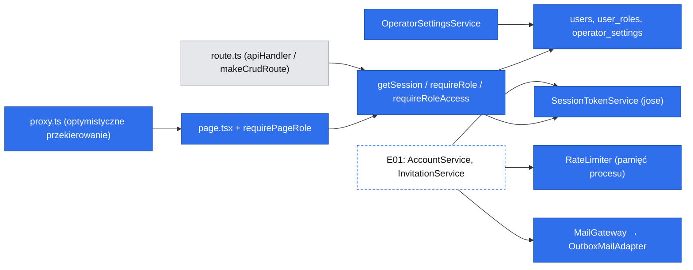
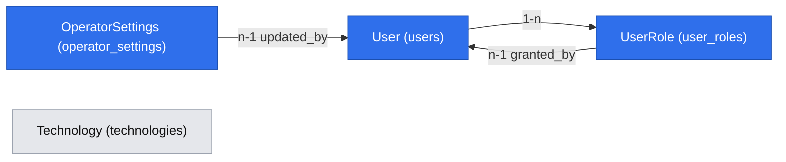

# Platform primitives — tożsamość, sesja, role, limiter, port e-mail, konfiguracja operatora

> Status: **zaakceptowana** (Natalia, 2026-10-18), **rewizja 5** (zmiany wynikające z rewizji 1–2 E01 i grill-me, zob. „Revision log”); grill-me zakończony (G1–G11, 2026-10-18). Pierwszy konsument: `2026-10-18-e01-konta-i-role.md` (E01, #11). Kolejni: E02-S02 #22 (widełki), E02 (publikacja oferty tylko z potwierdzonym e-mailem, G7), E03 (rezerwacja tylko dla zalogowanych z potwierdzonym e-mailem), E04 (prowizja), E05 (pomiar zalogowanych odwiedzających, D23).

## 📝 TLDR

Dziś `getSession()` zawsze zwraca `null` (`packages/core/src/http/session.ts`), więc każda chroniona trasa odpowiada 401, a panel `/admin` renderuje się bez kontroli dostępu. Proponujemy (przyszłe zachowanie) wspólną warstwę, z której korzystają wszystkie epiki: tożsamość użytkownika z wieloma rolami (`mentee`, `mentor`, `operator`), prawdziwą sesję (JWT `HS256` w ciasteczku `httpOnly`), egzekwowanie ról w API i na stronach, limiter prób w pamięci procesu, port e-mail z adapterem „skrzynka deweloperska” oraz konfigurację operatora (widełki cen D17/R18, prowizja R09) w bazie, edytowaną z panelu. Ta warstwa nie daje sama żadnej funkcji produktu. Przepływy kont (rejestracja, logowanie, zaproszenia) dostarcza E01.

## ⚠️ Open Questions

Wszystkie pytania Q1–Q6 rozstrzygnięte 2026-10-18 (zob. „Decisions in play”). Q15–Q17 (E01) również rozstrzygnięte. Brak pytań blokujących.

## 📝 Problem Statement

- `getSession` to atrapa „fail closed”. `requireRole` porównuje jedną rolę, a `assertOwnership` istnieje, ale nikt go jeszcze nie woła.
- Strony `/admin/*` nie mają bramki. Dziś to bezpieczne tylko dlatego, że zapisy w API odpowiadają 401. Gdy pojawi się prawdziwa sesja, `makeCrudRoute` z domyślnym `requireSession` pozwoliłby **każdemu zalogowanemu mentee** zapisywać słownik technologii (`api/technologies/route.ts`). Bramka ról musi więc wejść **przed** pierwszą ścieżką tworzenia kont albo razem z nią.
- `AGENTS.md` → „Bezpieczeństwo” przesądza już parametry auth: bcryptjs ≥ 12, JWT HS256, sekret ≥ 32 B, ~24 h, bez refresh tokenów, `httpOnly`/`secure`/`sameSite=lax`, rate limiting i ogólne komunikaty. Ta specyfikacja je realizuje, a nie renegocjuje.
- D17 stawia widełki „w konfiguracji operatora”, a D19 zakłada, że widełki zmieniają się w czasie. Zmiana nie może więc wymagać deployu.
- Weryfikacja e-maila, reset hasła i zaproszenia (E01) wymagają wysyłki poczty. Prawdziwego dostawcy w 1.0 kursowym nie ma (analogicznie do D20).

## 📝 Proposed Solution

1. **Tożsamość:** encje `User` i `UserRole` (koncepcja `auth`). Konto ma zbiór ról. Każde konto z rejestracji dostaje `mentee`. `mentor` dodaje zaproszenie (E01), a `operator` tylko skrypt CLI (E01-F1), na osobnym koncie bez innych ról.
2. **Sesja:** JWT (`jose`, HS256) w ciasteczku `devmentor_session` zawiera tylko `sub` (userId), `sv` (wersję sesji) i `exp`. `getSession` weryfikuje token i **przy każdym żądaniu czyta użytkownika i role z bazy**. Dzięki temu nadanie roli mentora działa od razu, a podbicie `session_version` (np. po resecie hasła) unieważnia wszystkie stare tokeny. To minimalne odwołanie sesji bez refresh tokenów i bez tabeli sesji. **Wygasanie jest przesuwane** (grill-me G3): aktywny użytkownik nie zostaje wylogowany w trakcie rezerwacji (E03) ani sesji tekstowej (E04), a nieaktywny wygasa po 24 h.
3. **Bramki:** API jest autorytetem (`requireSession` / `requireRole` / nowe `requireRoleAccess(role)` dla `makeCrudRoute`). Strony sprawdzają rolę po stronie serwera w samym `page.tsx` (komponent pod `<Suspense>`), a nie w layoutcie (Next 16: layout nie renderuje się ponownie przy nawigacji, zob. `node_modules/next/dist/docs/01-app/02-guides/authentication.md` → „Layouts and auth checks”). `proxy.ts` robi tylko optymistyczne przekierowanie do `/login`, gdy brak ciasteczka.
4. **Limiter:** singleton w kontenerze głównym, okno stałe, liczniki w `Map` w pamięci procesu (Q6: jedna instancja). Nowy błąd `TooManyRequestsError` → 429 i kod `TOO_MANY_REQUESTS`.
5. **Port e-mail:** `MailGateway` + adapter `outbox` (bufor ostatnich wiadomości w pamięci, podgląd tylko dla operatora). Prawdziwy dostawca to osobne, nieblokujące zadanie (decyzja Q4, wzorem D20).
6. **Konfiguracja operatora** (w tej specyfikacji z decyzji Q5, choć E01 jej nie używa; pierwszy konsument to E02-S02 #22, prowizji — E04): jednowierszowa tabela `operator_settings` z widełkami 25/50 min i prowizją, zasilona migracją wartościami D17/R09 i edytowana w `/admin/settings`.

**Odrzucone alternatywy:**
- **Gotowa biblioteka auth (Auth.js, Better Auth).** Narzuca własny model sesji i tabel. `AGENTS.md` przesądza JWT + bcryptjs, a integracja z Awilix/MikroORM i kopertą API kosztowałaby więcej niż ~300 linii własnego kodu.
- **Sesje w tabeli zamiast JWT.** Dają pełne odwołanie, ale łamią ustalenie z `AGENTS.md`. `session_version` daje to, czego potrzebujemy (reset hasła), za jedną kolumnę.
- **Rola w JWT bez odczytu z bazy.** Nadanie roli mentora działałoby dopiero po ponownym zalogowaniu (do 24 h), a odebranie roli wcale.
- **Widełki w `.env` lub stałych.** Odrzucone decyzją Q5: zmiana wymagałaby deployu.

## 📝 Research — czego uczą liderzy

- **Lucia (wytyczne po wygaszeniu biblioteki), Better Auth:** zalecają sesje odwoływalne. Bierzemy minimum, czyli `session_version` w JWT. Pełnego „wyloguj wszystkie urządzenia” nie robimy (Q14).
- **Auth.js:** ostrzega przed łączeniem kont po e-mailu (`allowDangerousEmailAccountLinking`). Łączenie bierzemy tylko z potwierdzonym adresem i przejmujemy ich zabezpieczenie przed pre-account takeover (szczegóły w E01).
- **OWASP (Forgot Password, Session Management):** tokeny jednorazowe, krótkotrwałe, w bazie tylko jako hash, a odpowiedź na „zapomniałem hasła” nie zdradza, czy konto istnieje. Wymagania z tej listy realizujemy w E01. Tutaj dostarczamy narzędzia: generator tokenów, hash i limiter.
- **Czego nie bierzemy:** MFA, WebAuthn, wielu dostawców OAuth, kont organizacyjnych ani RBAC z uprawnieniami. To funkcje „na zapas” (`AGENTS.md`).

## 📝 Architecture



Każda decyzja dostępu przechodzi przez `getSession` w `core`. Strony i trasy różnią się tylko tym, skąd biorą wartość ciasteczka. E01 jest pierwszym klientem limitera, poczty i wydawania tokenów.

**Umiejscowienie (koncepcje i pliki):**

| Element | Plik | Rejestracja |
|---|---|---|
| `User`, `UserRole` | `db/src/entities/auth/{user,user-role}.entity.ts` | `entities/index.ts` |
| `OperatorSettings` | `db/src/entities/settings/operator-settings.entity.ts` | `entities/index.ts` |
| `SessionTokenService` (podpis/weryfikacja JWT, budowa ciasteczka) | `core/src/services/auth/session-token.service.ts` | `AppCradle.sessionTokenService`, singleton |
| `getSession`, `getSessionFromCookieValue` | `core/src/http/session.ts` | — (funkcje modułu, same wołają `getContainer`/`withScope`) |
| `requireRole`, `requireRoleAccess` | `core/src/http/auth.ts` | — |
| `RateLimiter` | `core/src/services/rate-limit/rate-limiter.service.ts` | `AppCradle.rateLimiter`, singleton |
| `MailGateway` (port), `OutboxMailAdapter` | `core/src/services/mail/mail.port.ts`, `core/src/services/mail/adapters/outbox-mail.adapter.ts` | `AppCradle.mailGateway`, singleton, wybór wg `env.MAIL_ADAPTER` |
| `OperatorSettingsService` | `core/src/services/settings/operator-settings.service.ts` | `RequestCradle.operatorSettingsService`, scoped |
| `operatorSettingsUpdateSchema` | `core/src/validators/settings/operator-settings-update.schema.ts` | — |
| Ustawianie ciasteczek z tras | `apiHandler`: handler może zwrócić `withCookies(data, cookies)` (rozszerzenie addytywne) | — |
| Bramka stron | `packages/app/app/_lib/require-page-role.ts` (folder prywatny `_lib`, więc nie jest trasą i mieści się w zakresie pokrycia `packages/app/app/**`; czyta `cookies()` z `next/headers`, woła `getSessionFromCookieValue`) | — |
| Optymistyczne przekierowanie | `packages/app/proxy.ts` — **poza** globem pokrycia, więc krok 6 dopisuje go do `include` w `vitest.config.ts` (rozszerzenie zakresu, nie wyłączenie) | — |
| Przekierowania z tras (OAuth i każde przyszłe) | `core/src/http/redirect-handler.ts` — `redirectHandler()`, drugi kanoniczny wrapper obok `apiHandler`: ten sam kontrakt logowania błędów i braku stack trace'ów, w tym **logowanie wyłącznie `pathname`, nigdy pełnego URL-a z query stringiem** (callback OAuth niesie `code` i `state`); tylko metody `GET` (bez CSRF, bo nie zmieniają stanu poza sesją); `AppError` → `302 /login?error=<kod>`, nieoczekiwany błąd → log i `/login?error=unexpected` | — |
| Bezpieczny powrót `next` | `core/src/http/safe-next-path.ts` — przyjmuje tylko ścieżkę względną zaczynającą się od `/`, nie `//` ani `/\\`, bez schematu; inaczej `/` | — |

**Kontrakt sesji (`core`):**

```ts
export type Role = "mentee" | "mentor" | "operator";
export interface Session { userId: string; roles: readonly Role[]; emailVerified: boolean }
requireSession(request): Promise<Session>          // 401
requireRole(session, role): void                   // 403, gdy roles nie zawiera role
requireRoleAccess(role): AccessRule                // dla makeCrudRoute: sesja + rola
// requireVerifiedEmail dodaje pierwszy konsument (E02 — publikacja oferty, G7 — albo E03 — rezerwacja); prymitywy dostarczają tylko Session.emailVerified
```

**`getSession` krok po kroku (fail closed):**
1. Brak ciasteczka → `null`.
2. Zły podpis, inny algorytm niż HS256, wygasły token albo brak `sub`/`sv` → `null`.
3. Użytkownik nie istnieje albo `sv` ≠ `users.session_version` → `null`.
4. Wynik: `{ userId, roles, emailVerified }`.

**Przesuwane wygasanie (G3):** stałe `SESSION_TTL = 24 h` (`AGENTS.md`) i `SESSION_RENEW_THRESHOLD = 12 h` (połowa TTL, więc odnowienie najwyżej raz na pół doby aktywności). Gdy `requireSession` przyjmie token, któremu zostało mniej niż `SESSION_RENEW_THRESHOLD`, zapamiętuje żądanie do odnowienia (`WeakMap<Request, Session>` w `core/src/http/session.ts`). `apiHandler` po **udanym** handlerze dokleja ciasteczko z nowym tokenem (`exp` = teraz + 24 h, ten sam `sv`). Przy błędzie handlera nie odnawia, a przy wylogowaniu wygrywa wyczyszczone ciasteczko. To nie jest refresh token: nie ma drugiego, długożyjącego tokenu, więc reguła z `AGENTS.md` zostaje nienaruszona. Strony (komponenty serwerowe) nie odnawiają, bo nie mogą ustawiać ciasteczek przy renderze. Odnowienie następuje przy pierwszym wywołaniu API, które każda strona panelu i tak robi przez `apiCall`.

Błąd bazy przy odczycie leci dalej, a `apiHandler` zamienia go na 503. Nigdy nie traktujemy go jako „zalogowany”. Weryfikacja podpisu zawsze z jawnym `algorithms: ["HS256"]`.

**Bramki stron:**
- `requirePageRole(role)` w `page.tsx` (komponent serwerowy pod `<Suspense>`, zaczyna od `await connection()`).
- Brak sesji → `redirect("/login?next=<ścieżka>")`.
- Sesja bez roli → widok „Brak dostępu” (`feedback/error-message`). **Bez `forbidden()`**: w tej wersji Next wymaga flagi `experimental.authInterrupts` (`node_modules/next/dist/docs/01-app/03-api-reference/04-functions/unauthorized.md`), a eksperymentalnej flagi do bramki bezpieczeństwa nie włączamy. Autorytetem jest API (403), a strona tylko nie pokazuje danych.

## 📝 Data Model

Kwoty w groszach (`int`), czas w `timestamptz`, ID UUID z `baseProperties`. Limity w `db/src/constants.ts`.

**`users`** (koncepcja `auth`). E01 dopisuje `password_hash` i `github_user_id` własną migracją.

| Kolumna | Typ | Uwagi |
|---|---|---|
| `email` | `varchar(254)` NOT NULL **UNIQUE** | znormalizowany: `trim` + małe litery (normalizacja w walidatorze i serwisie) |
| `email_verified_at` | `timestamptz` NULL | `NULL` = niepotwierdzony; warunek pierwszej rezerwacji (Q8, E03) i publikacji oferty mentora (G7, E02) |
| `display_name` | `varchar(80)` NOT NULL | Q13 |
| `session_version` | `int` NOT NULL DEFAULT 1 | podbijane przy resecie hasła i przejęciu konta przez łączenie z GitHubem |

**`user_roles`**

| Kolumna | Typ | Uwagi |
|---|---|---|
| `user_id` | FK → `users.id` ON DELETE CASCADE | |
| `role` | enum `mentee` \| `mentor` \| `operator` | |
| `granted_by_id` | FK → `users.id` NULL, ON DELETE SET NULL | operator, który zaprosił; `NULL` dla rejestracji i CLI |
| | **UNIQUE (`user_id`, `role`)** | nadanie roli idempotentne pod constraintem, bez check-then-write |

Brak tabeli uprawnień. Role to stała lista, a sprawdzanie to `roles.includes(role)`.

**`operator_settings`** (koncepcja `settings`). Dokładnie jeden wiersz.

| Kolumna | Typ | Uwagi |
|---|---|---|
| `singleton` | `boolean` NOT NULL DEFAULT true, **UNIQUE**, `CHECK (singleton)` | wymusza jeden wiersz w bazie |
| `price_min_25`, `price_max_25` | `int` NOT NULL | grosze; seed 8000 / 21500 (D17) |
| `price_min_50`, `price_max_50` | `int` NOT NULL | grosze; seed 15000 / 43000 (D17) |
| `commission_bps` | `int` NOT NULL | punkty bazowe; seed 2000 = 20% (R09) |
| `updated_by_id` | FK → `users.id` NULL, ON DELETE SET NULL | kto ostatnio zmienił (audyt minimalny) |
| | `CHECK (price_min_25 <= price_max_25 AND price_min_50 <= price_max_50 AND commission_bps BETWEEN 0 AND 10000)` | niezmiennik w bazie, nie tylko w Zod |

Waluta PLN jest stałą w `constants.ts`, nie kolumną (brak wielowalutowości w 1.0). Historii zmian widełek nie trzymamy: D19 porównuje bieżącą cenę mentora z bieżącymi widełkami (E02).

**Migracje:** `auth-users-and-roles` (tabele `users`, `user_roles`) i `settings-operator-settings` (tabela + wiersz seed stałymi literałami, zgodnie z lekcją o `addSql` bez parametrów). Obie z `.snapshot-*.json` i testem w górę i w dół.

**Dane wrażliwe:**
- `email` i `display_name` to dane osobowe. Nie trafiają do logów: dopisać `email`, `*.email` do `LOG_REDACT_PATHS`, a do tego `cookie`, `*.cookie`, `authorization`, `*.authorization`, `set-cookie`, `*.secret`, `url`, `*.url` (pełne adresy mogą nieść tokeny w query stringu).
- Usunięcie konta i eksport danych to otwarte pytanie powiązane z Q09 (zob. E01).



`Technology` nie ma relacji z nowymi encjami. Zmienia się tylko dostęp do zapisu jej trasy (tylko `operator`).

## 📝 API Contracts

Wszystko przez `apiHandler` i kopertę `{ ok, data }`. Zmiany istniejących powierzchni opisuje „Risks & Impact Review”.

| Metoda i trasa | Dostęp | Wejście | Wyjście / błędy |
|---|---|---|---|
| `GET /api/operator-settings` | `mentor` lub `operator` | — | `{ priceMin25Pln, priceMax25Pln, priceMin50Pln, priceMax50Pln, commissionPercent, updatedAt }` |
| `PUT /api/operator-settings` | `operator` | `operatorSettingsUpdateSchema`: liczby całkowite PLN > 0, `min ≤ max` (refine z błędem przy polu `max`), `commissionPercent` całkowite 0–100 | jak wyżej; 400 z `fieldErrors`; 403 |
| `GET /api/mail/outbox` | `operator`; **404, gdy `MAIL_ADAPTER` ≠ `outbox`** | — | ostatnie ≤ 100 wiadomości `{ id, to, subject, text, sentAt }`, od najnowszej |
| `GET\|POST\|PUT\|DELETE /api/technologies` | odczyt publiczny; **zapisy: `operator`** (dziś: dowolna sesja) | bez zmian | bez zmian; nowe 403 dla nie-operatora |

Serwis przelicza PLN na grosze. Zod i formularz pracują na pełnych złotówkach, bo D17 podaje widełki w pełnych PLN.

**Zmienne środowiskowe** (`env.ts` + `.env.example`; build dalej bez `.env`):

| Zmienna | Walidacja | Domyślna |
|---|---|---|
| `AUTH_JWT_SECRET` | wymagana, ≥ 32 bajty (UTF-8) | brak; **krok instalatora `env-file` generuje losowy sekret** (`crypto.randomBytes(48).toString("base64url")`), jeśli brak |
| `APP_BASE_URL` | URL `http(s)` | `http://localhost:3000` (linki w e-mailach, callback OAuth) |
| `APP_ENV` | enum `local` \| `test` \| `staging` \| `production` | **`production`** (fail closed: brak konfiguracji = najostrzejsze reguły). Mówi, *gdzie* działa aplikacja; `NODE_ENV` zostaje do spraw Reacta i Next (`next start` zawsze ustawia `NODE_ENV=production`, także na stagingu i w testach integracyjnych, więc nie odróżnia stagingu od produkcji). Instalator wpisuje `local`, `globalSetup` testów integracyjnych — `test`. |
| `MAIL_ADAPTER` | enum `outbox` \| `noop`; **`outbox` przy `APP_ENV=production` → błąd `parseEnv`** (fail closed) | `outbox` przy `APP_ENV` ≠ `production`, `noop` przy `production` (prawdziwy dostawca dopisze nową wartość) |

**Port e-mail:**

```ts
export interface MailMessage { to: string; subject: string; text: string }
export interface MailGateway { send(message: MailMessage): Promise<void> }
```

- Tylko tekst, bez szablonów HTML.
- Treść wiadomości budują serwisy koncepcji (E01: `auth-mail.ts`).
- Kontrakt: `send` może rzucić. Wołający wysyła **po** `em.flush()`, żeby wiadomość nie wyszła dla wycofanej transakcji, a błąd wysyłki loguje i obsługuje wg własnej reguły (E01).
- Adapter `outbox` loguje tylko `{ messageId, subject }`. Adresat i treść (zawiera tokeny) nie trafiają do logów.
- **Outbox ujawnia operatorowi żywe linki weryfikacji i resetu każdego użytkownika**, czyli daje operatorowi możliwość przejęcia dowolnego konta. Dlatego działa wyłącznie poza produkcją (lokalnie, w CI, w testach integracyjnych), a `parseEnv` odrzuca go w produkcji. W produkcji bez prawdziwego dostawcy działa `noop`: loguje `{ messageId, subject }` i nic nie wysyła. Strony dowiadują się o tym przez `isMailDeliveryAvailable(env)` (`false` dla `noop`) — E01 pokazuje wtedy ostrzeżenie na `/register`. Link zaproszenia operator i tak dostaje w odpowiedzi (E01).

**Limiter:**

```ts
interface RateLimiter { consume(key: string, rule: RateLimitRule): void }   // rzuca TooManyRequestsError
interface RateLimitRule { limit: number; windowMs: number }
```

- Reguły (nazwane stałe) definiuje konsument (E01).
- `Map` ma górny limit wpisów (`RATE_LIMIT_MAX_KEYS = 10_000`). Wygasłe wpisy są sprzątane przy dostępie, a po przekroczeniu limitu wpisów usuwamy najstarsze, żeby zalew unikalnych kluczy nie wyczerpał pamięci.
- Adres klienta do kluczy (`clientIp(request)` w `core/http`): **ostatni** adres z `x-forwarded-for`, czyli ten dopisany przez nasz reverse proxy, a nie pierwszy, który podaje klient. Gdy nagłówka brak — stała `"unknown"`. Bez flagi `TRUST_PROXY` i bez konfiguracji zaufanych proxy (jedna instancja, Q6). **Bez reverse proxy przed aplikacją klient kontroluje ten nagłówek**, więc klucze po IP są tylko pierwszą linią obrony. Konsument, który dokłada klucz bez IP, przyjmuje ryzyko blokady cudzego konta — E01 świadomie tego nie robi przy logowaniu (rewizja 2 E01). Zob. Risks.

## 📝 UI/UX

- **`/admin/settings`** (grupa `(operator)`): `CrudForm` w trybie edycji, pięć pól liczbowych z sufiksem „PLN” / „%”, błędy przy polach, „Zapisano” po sukcesie. Pod formularzem informacja: „Zmiana widełek nie zmienia cen mentorów. Mentor z ceną poza widełkami zobaczy ostrzeżenie przy następnej edycji (D19)”.
- **`/admin/outbox`** (tylko przy `MAIL_ADAPTER=outbox`): `DataTable` z kolumnami: data, adresat, temat. Wiersz rozwija treść, a linki w treści są klikalne. Nad tabelą stała adnotacja: „Skrzynka deweloperska — wiadomości nie są wysyłane”.
- Nawigacja panelu operatora: „Przegląd”, „Technologie”, „Konfiguracja”, „Skrzynka” (ostatnia tylko z outboxem); E01 dodaje „Zaproszenia”.
- Stany: ładowanie, błąd i brak dostępu przez `feedback/*`. Strona bez sesji przekierowuje do `/login?next=…` (strona logowania z E01; do jej wdrożenia przekierowanie prowadzi do 404, czego nikt nie zobaczy, bo bez kont nie ma sesji).

## 📝 Edge Cases & Failure Scenarios

| Sytuacja | Zachowanie |
|---|---|
| Ciasteczko z tokenem podpisanym innym sekretem (rotacja `AUTH_JWT_SECRET`) | `null` → 401 / przekierowanie do logowania; rotacja sekretu = wylogowanie wszystkich (udokumentować w README) |
| Token z `alg: none` lub RS256 | odrzucony (jawna lista algorytmów) |
| Konto usunięte z bazy, a token ważny | `null` |
| Rola mentora nadana w trakcie sesji | widoczna od następnego żądania (role z bazy) |
| Baza niedostępna przy `getSession` | 503 z `apiHandler`; strona pokazuje `error-message`; nigdy dostęp |
| Brak `AUTH_JWT_SECRET` lub sekret za krótki | `parseEnv` rzuca przy pierwszym żądaniu, komunikat podaje nazwę zmiennej bez wartości; build przechodzi |
| Dwóch operatorów zapisuje konfigurację jednocześnie | wygrywa ostatni zapis (jeden wiersz, brak wersjonowania); akceptowalne przy jednym operatorze |
| `min > max` wysłane z pominięciem formularza | 400 z Zod; gdyby Zod przepuścił, `CHECK` w bazie → 500 zalogowany, bez zapisu |
| Restart procesu | liczniki limitera i skrzynka outbox znikają (akceptowane przy jednej instancji, Q6) |
| Zalew unikalnych kluczy limitera | górny limit wpisów; najstarsze usuwane |

## 📝 Risks & Impact Review

**Zmiany kontraktów (`BACKWARD_COMPATIBILITY.md`):**

| Powierzchnia | Zmiana | Ocena | Ścieżka |
|---|---|---|---|
| §6 eksporty `@devmentor/core` | `Role` zmienia wartości (`student`→`mentee`, `admin`→`operator`); `Session.role` → `Session.roles` | 💥 łamiąca; konsumenci tylko w testach (`auth.test.ts`, `auth-with-session.test.ts`) | wszyscy konsumenci w tym samym PR-ze |
| §5 trasy stron | grupa `(admin)` → `(operator)` | niełamiąca: nazwa grupy nie wchodzi do URL, `/admin` zostaje | aktualizacja ścieżek w testach (`packages/app/test/*`) |
| §4 trasy HTTP | zapisy `/api/technologies`: „dowolna sesja” → `operator` | zaostrzenie dostępu = zmiana bezpieczeństwa; dziś nikt nie ma sesji, więc nikt nie traci dostępu | etykieta `security`; test 403 dla mentee |
| §4 trasy HTTP | nowe `/api/operator-settings`, `/api/mail/outbox` | addytywne | dopisać do listy w `BACKWARD_COMPATIBILITY.md` |
| §6 eksporty `@devmentor/core` | nowe `redirectHandler`, `safeNextPath`, `requireRoleAccess`, `withCookies` | addytywne; `redirectHandler` staje się kanonicznym wrapperem dla tras z przekierowaniem | dopisać do listy sygnatur publicznych w §6 i do `AGENTS.md` („Wspólna warstwa API”) |
| §2 koperta API | nowy kod `TOO_MANY_REQUESTS` (429) | rozszerzenie listy kodów | `core` (`errors.ts`, `api-handler.ts`) i `ui` (`types.ts`, `api-call.ts`) w jednym PR-ze + test integracyjny |
| §7 env | nowa `APP_ENV` (domyślnie `production`) | niełamiąca dla produkcji; lokalnie bez wpisu outbox jest odrzucany | instalator dopisuje `APP_ENV=local`; `.env.example` |
| §7 env | nowa wymagana `AUTH_JWT_SECRET` | 💥 łamiąca dla istniejących `.env` | instalator generuje sekret; `.env.example`; opis w PR-ze |
| §1 schemat | 2 migracje, nowe tabele | addytywne; `risk-high` | test up/down; plan wycofania: `migration:down` usuwa tabele; dane kont tracone (przed wydaniem brak danych) |

**Ryzyka:**
- **Limiter i outbox w pamięci procesu (Q6).** Przy więcej niż jednej instancji albo serverless limiter przestaje chronić (każda instancja liczy osobno), a skrzynka pokazuje losowy podzbiór. **Przy zmianie wdrożenia na kilka instancji przenosimy liczniki do PostgreSQL** (tabela `rate_limit_buckets` z `INSERT … ON CONFLICT … RETURNING`), a outbox zastępuje prawdziwy dostawca. Interfejs `RateLimiter` się nie zmienia.
- **Adapter outbox to nie poczta i nie działa w produkcji.** Dopóki nie ma prawdziwego dostawcy, wdrożenie produkcyjne ma `noop`: użytkownik nie dostanie linku weryfikacyjnego ani resetu, więc konto e-mail + hasło nie potwierdzi adresu i nie zarezerwuje (Q8). Konta z GitHuba mają adres potwierdzony od razu. To spójne z 1.0 kursowym (płatności też są mockiem, D20), ale **start z prawdziwymi użytkownikami wymaga zadania „adapter dostawcy e-mail”** obok Stripe (#28) i regulaminu (Q09).
- **Odczyt użytkownika przy każdym żądaniu z sesją.** Jedno zapytanie po kluczu głównym na żądanie. Akceptowalne w 1.0; cache to przedwczesna optymalizacja.
- **IP za proxy.** Bez znanego reverse proxy nagłówek `x-forwarded-for` da się podrobić, a limiter po IP da się obejść. E01 limituje po samym e-mailu tylko żądania resetu i rejestrację (`reset-request:email`, `register:email` — blokada nie odcina właściciela od konta). Logowanie limituje wyłącznie z IP, więc rozproszone zgadywanie hasła jednego konta ograniczają w 1.0 tylko bcrypt i długość hasła, a od etapu B także odrzucanie najczęstszych haseł (G5; zob. Risks E01). Przy wdrożeniu ustalić, który proxy dopisuje nagłówek.
- **JWT bez pełnego odwołania.** Wylogowanie czyści ciasteczko, ale skopiowany token działa do `exp` (24 h), chyba że podbijemy `session_version`. Znane ograniczenie z `AGENTS.md`.
- **Przesuwane wygasanie (G3) przedłuża życie skradzionego tokenu**, dopóki napastnik go aktywnie używa (każde odnowienie daje kolejne 24 h). Bez górnej granicy czasu życia sesji. Ograniczają to `httpOnly` (brak odczytu z JS) i `session_version` (reset hasła unieważnia wszystkie tokeny). Bezwzględny limit życia sesji (np. 7 dni od zalogowania, pole `iat0` w tokenie) wraca, gdy pojawią się prawdziwi użytkownicy.

## 📝 Decisions in play

| Id | Treść | Właściciel | Wpływ na specyfikację |
|---|---|---|---|
| D13 / R17 | konto przed rezerwacją | Natalia | `requireSession`; `Session.emailVerified` (bramkę `requireVerifiedEmail` dodaje pierwszy z E02/E03) |
| D17 / R18, D19 | widełki w konfiguracji operatora, zmiana bez kodu | Natalia | tabela `operator_settings`, seed D17 |
| R09 | prowizja 20% | Natalia | `commission_bps` = 2000 |
| D18 / R21 | rola mentora z zaproszenia | Natalia | wiele ról na koncie, `granted_by_id` |
| D20 (analogia) | port + mock, prawdziwy dostawca osobno | Natalia | `MailGateway` + `outbox` |
| **PP-1 (nowa, 2026-10-18)** | **Nazwy ról zmienione na nazewnictwo briefu: `student`→`mentee`, `admin`→`operator`, grupa tras `(admin)`→`(operator)`, planowana `(student)`→`(mentee)`.** Świadoma zmiana łamiąca §6, zweryfikowana z `BACKWARD_COMPATIBILITY.md` (tabela wyżej). URL `/admin` zostaje, bo nazwa grupy nie wchodzi do adresu. | Natalia (Q2) | `AGENTS.md` („Trasy i UI”) i `engineering-standards.md` (wzmianki `student`) aktualizowane w tym samym PR-ze |
| PP-2 (Q1) | Konto ma zbiór ról; `mentee` + `mentor` mogą współistnieć; `operator` na osobnym koncie | Natalia | `user_roles` z UNIQUE (`user_id`, `role`) |
| PP-3 (Q5) | konfiguracja operatora w bazie, edycja z panelu | Natalia | Faza 3 |
| PP-4 (Q6) | jedna instancja w 1.0, limiter w pamięci | Natalia | adnotacja w Risks |
| G3 (grill-me) | przesuwane wygasanie sesji: odnowienie tokenu, gdy zostało < 12 h; nie jest to refresh token | Natalia | `requireSession` + `apiHandler`, krok 5b (etap B, G9) |

## 📋 Phasing

- **Faza 1 — Tożsamość, sesja i bramki ról.** Po niej istnieją tabele kont, prawdziwe `getSession` i egzekwowanie ról w API i na stronach. Kont nikt jeszcze nie zakłada (to E01-F1), więc zachowanie widoczne dla ludzi się nie zmienia, ale zapisy technologii wymagają już roli operatora. **Musi wejść przed E01-F1.**
- **Faza 2 — Limiter, kod 429 i port e-mail.** Kroki 7–9 są niezależne od fazy 1; krok 10 (podgląd skrzynki) wymaga bramek ról z fazy 1. Potrzebna przed E01-F1.
- **Faza 3 — Konfiguracja operatora.** Wymaga fazy 1. Testy używają fixture'a kont z kroku 3, więc faza nie zależy od E01. Musi być gotowa przed E02-S02 (#22).

### Kolejność wdrożenia — etapy (grill-me G9)

Budżet 1.0 (25 h, D03) nie mieści całego zakresu przed ścieżką krytyczną. Specyfikacja pozostaje kompletna, a kroki dzielą się na trzy etapy. Numery kroków oznaczają fazy, nie kolejność.

| Etap | Kiedy | Kroki primitives |
|---|---|---|
| **A — minimum kursowe** | przed E01 (blokuje ścieżkę krytyczną) | 1–4; 5 **bez** przesuwanego wygasania; 6; 7–10 (limiter, 429, port e-mail z outboxem i `noop`, podgląd skrzynki — potrzebne do weryfikacji e-maila, od której zależą bramki E02/E03) |
| **A′ — przed E02-S02** | po E01 etap A, przed #22 | 11–13 (konfiguracja operatora — pierwszy konsument to widełki w E02-S02) |
| **B — ochrony dla prawdziwych użytkowników** | **po ścieżce krytycznej (E02–E05)**, przed startem z prawdziwymi użytkownikami | 5b: przesuwane wygasanie sesji (G3) jako osobny krok. W 1.0 kursowym sesja wygasa sztywno po 24 h, a w demonstracji wystarczy zalogować się ponownie |

Kolejność całości: **primitives A → E01 A → primitives A′ → E02 → E03 → E04 → E05 → primitives B + E01 B** (zob. E01 → Phasing).

## 📋 Implementation Plan

Każdy krok kończy się zielonym `npm run lint`, `npm run typecheck` i `npm test` (100% pokrycia na plik). Kroki z migracją mają test w górę i w dół.

### Faza 1 — Tożsamość, sesja i bramki ról

1. **Zmiana nazw ról (PP-1).** `Role = "mentee" | "mentor" | "operator"`; `Session { userId, roles, emailVerified }`; `requireRole` sprawdza `roles.includes`; nowe `requireRoleAccess(role)` (AccessRule). Grupa `(admin)` → `(operator)` (`git mv`), testy app z nowymi ścieżkami, `AGENTS.md` i `engineering-standards.md`. `getSession` dalej zwraca `null`. *Test:* jednostkowe dla `requireRole` z wieloma rolami, `requireRoleAccess`.
2. **Zapisy technologii tylko dla operatora.** `api/technologies/route.ts`: `access: { read: "public", write: requireRoleAccess("operator") }`. *Test:* trasa z podmienionym `getSession` → mentee 403, operator 200. Wchodzi przed krokiem 5, żeby nie było okna, w którym sesja istnieje, a zapis jest otwarty.
3. **Encje `User`, `UserRole` + migracja `auth-users-and-roles` + fixture testowy kont.** Stałe w `constants.ts` (`EMAIL_MAX_LENGTH = 254`: limit adresu z RFC 5321; `DISPLAY_NAME_MAX_LENGTH = 80`). Fixture `tests/integration/support/accounts.ts`: tworzy użytkownika z rolami przez encje MikroORM (bez SQL) i podpisuje dla niego token sesji. Prymitywy nie mają serwisu zakładania kont (to E01), a testy bramek go potrzebują. *Test:* integracyjny migracji up/down; UNIQUE na `email` i (`user_id`, `role`).
4. **Konfiguracja sesji.** `AUTH_JWT_SECRET` i `APP_BASE_URL` w `env.ts` i `.env.example`; krok instalatora `env-file` dopisuje wygenerowany sekret do istniejącego `.env` bez nadpisywania innych wartości; nowe ścieżki w `LOG_REDACT_PATHS`. *Test:* `parseEnv` odrzuca sekret < 32 B; test kroku instalatora (sekret dopisany raz, ponowne uruchomienie go nie zmienia).
5. **`SessionTokenService` i prawdziwe `getSession`.** Zależność `jose` w `@devmentor/core`. Funkcje `sign(user)`, `verify(token)`, `buildSessionCookie(token)` (`httpOnly`, `sameSite=lax`, `secure` gdy `APP_ENV` = `staging` lub `production` (G2: `NODE_ENV` nie odróżnia środowisk), `path=/`, `Max-Age=86400`) i `clearSessionCookie()`. `getSession` / `getSessionFromCookieValue` wg algorytmu z Architecture. `apiHandler` przyjmuje `withCookies(data, cookies)`. Sesja wygasa sztywno po 24 h (odnowienie to krok 5b). *Test:* jednostkowe dla każdej gałęzi `null` (brak, zły podpis, `alg`, wygasły, brak usera, `sv` ≠); test ciasteczek; test, że token nie trafia do logów.

   **5b. Przesuwane wygasanie sesji (G3) — etap B (G9).** `requireSession` oznacza żądanie do odnowienia, `apiHandler` po udanym handlerze dokleja nowe ciasteczko. *Test:* token z < 12 h → nowe ciasteczko; > 12 h → brak; błąd handlera → brak; wylogowanie → ciasteczko wyczyszczone, nie odnowione.
6. **Bramki stron, `redirectHandler`, `safeNextPath`.** `packages/app/app/_lib/require-page-role.ts`; `redirectHandler` i `safeNextPath` w `core/src/http` (pierwszy konsument: E01-F2 i strony logowania; test złośliwych wartości `next`: `//evil`, `/\evil`, `https://…`, `javascript:`); `page.tsx` w `(operator)` wołają go pod `<Suspense>`; `proxy.ts` z przekierowaniem `/admin/*`, `/mentor/*`, `/account` → `/login?next=…`, gdy brak ciasteczka (przed implementacją przeczytać `node_modules/next/dist/docs/01-app/01-getting-started/16-proxy.md`). *Test:* jednostkowe (redirect, 403, render); integracyjny: `/admin` bez ciasteczka → przekierowanie, z tokenem mentee z fixture'a → brak dostępu, z tokenem operatora → strona.

### Faza 2 — Limiter, 429, port e-mail

7. **`TooManyRequestsError` i kod `TOO_MANY_REQUESTS`.** `core/http/errors.ts`, mapowanie 429 w `apiHandler`, kopia kodu w `ui/backend/api/types.ts`, obsługa w `apiCall` (komunikat „Za dużo prób. Spróbuj za chwilę.”). *Test:* jednostkowe po obu stronach; aktualizacja §2 w `BACKWARD_COMPATIBILITY.md`.
8. **`RateLimiter`.** `consume`; okno stałe, `Map`, limit wpisów, wstrzykiwany zegar (`now: () => number`) do testów; rejestracja singletona. *Test:* limit, reset okna, wyrzucanie najstarszych, brak wycieku pamięci przy 10 001 kluczach.
9. **`MailGateway` + `OutboxMailAdapter` + `NoopMailAdapter` + `isMailDeliveryAvailable`.** `APP_ENV` i `MAIL_ADAPTER` w env i `.env.example` (domyślna `MAIL_ADAPTER` zależna od `APP_ENV`, `outbox` przy `APP_ENV=production` odrzucany; instalator dopisuje `APP_ENV=local`, `globalSetup` testów ustawia `APP_ENV=test`); bufor 100 wiadomości; log bez adresata i treści. *Test:* jednostkowe adapterów, wyboru adaptera, odrzucenia `outbox` przy `APP_ENV=production` i domyślnego `APP_ENV=production` przy braku zmiennej; integracyjny: aplikacja z `next start` i `APP_ENV=test` startuje z outboxem.
10. **Podgląd skrzynki.** `GET /api/mail/outbox` (operator; 404 przy innym adapterze) i `/admin/outbox` z `DataTable`. *Test:* trasa (401/403/404/200), strona (stany).

### Faza 3 — Konfiguracja operatora

11. **Encja `OperatorSettings` + migracja z seedem D17/R09.** `CHECK`-i i jedno-wierszowość. *Test:* integracyjny: drugi `INSERT` odrzucony, `min > max` odrzucone, seed obecny.
12. **`OperatorSettingsService` + walidator + `GET|PUT /api/operator-settings`.** Przeliczenie PLN↔grosze, `updated_by_id` z sesji. *Test:* serwis na `fake-entity-manager`, trasa (mentee 403 na GET i PUT, mentor 200 na GET i 403 na PUT, operator 200, `fieldErrors` przy `min > max`).
13. **Strona `/admin/settings`.** `CrudForm` + adnotacja D19; pozycja w nawigacji. *Test:* jednostkowy strony; integracyjny przez `agent-browser` na koncie operatora z fixture'a (krok 3): zmiana widełek zapisuje się i przetrwa przeładowanie.

**Weryfikacja całości:** `npm run build` bez `.env`; `npm run test:integration`; `npm audit` (nowa zależność `jose`). Kryteria akceptacji: (a) bez ciasteczka każda chroniona trasa → 401, a strona → przekierowanie; (b) mentee nie zapisuje technologii ani konfiguracji (403); (c) podbicie `session_version` unieważnia istniejący token, a (od etapu B, krok 5b) aktywny użytkownik z tokenem bliskim wygaśnięcia dostaje nowy przy wywołaniu API; (d) 429 po przekroczeniu limitu ma kopertę z `TOO_MANY_REQUESTS`; (e) operator zmienia widełki z panelu bez deployu; (f) żaden token, sekret, ciasteczko ani e-mail nie pojawia się w logach (test logów); (g) aplikacja z `APP_ENV=production` (także domyślnym) i `MAIL_ADAPTER=outbox` nie obsługuje żądań (błąd konfiguracji), a staging (`APP_ENV=staging`) i testy integracyjne działają z outboxem mimo `NODE_ENV=production`.

## 📝 Revision log

| Data | Rewizja | Zmiany | Źródło |
|---|---|---|---|
| 2026-10-18 | 0 | Pierwsza wersja zaakceptowana (Q1–Q6, review z czystym kontekstem: outbox tylko poza produkcją, fixture kont, `redirectHandler` w primitives). | Natalia |
| 2026-10-18 | 1 | Limiter: `peek`/`hit` obok `consume` (E01: `login:email` liczy tylko porażki). `isMailDeliveryAvailable(env)` dla ostrzeżenia na `/register` przy `noop`. `redirectHandler` loguje tylko `pathname`; `url`, `*.url` w `LOG_REDACT_PATHS`. | Rewizja 1 E01 (przegląd Gemini i GPT + uwagi Natalii) |
| 2026-10-18 | 2 | `peek`/`hit` usunięte z `RateLimiter` — jedynym konsumentem był `login:email`, usunięty w rewizji 2 E01; interfejs wraca do samego `consume`. Opis ryzyka IP za proxy zaktualizowany. | Natalia |
| 2026-10-18 | 3 | Grill-me G2: nowa zmienna `APP_ENV` (`local`/`test`/`staging`/`production`, domyślnie `production`); zabezpieczenie outboxa opiera się na `APP_ENV`, nie na `NODE_ENV` (który `next start` zawsze ustawia na `production`, co blokowało staging z G1 i testy integracyjne). | Natalia (grill-me) |
| 2026-10-18 | 4 | Grill-me G3: przesuwane wygasanie sesji (odnowienie przy < 12 h z 24 h, w `apiHandler` po udanym handlerze); ryzyko braku bezwzględnego limitu życia sesji w Risks. | Natalia (grill-me) |
| 2026-10-18 | 5 | Grill-me G9: etapy wdrożenia A (minimum kursowe), A′ (konfiguracja operatora przed E02-S02), B (ochrony dla prawdziwych użytkowników po E02–E05); przesuwane wygasanie sesji przeniesione do etapu B. | Natalia (grill-me) |
| 2026-10-18 | spójność | Poprawki spójności po przeglądzie agentem z czystym kontekstem — tylko brzmienie, bez zmian merytorycznych (odwołania do etapów G9, `APP_ENV` zamiast `NODE_ENV` dla flagi `secure` zgodnie z G2, G7 w opisach weryfikacji, liczba migracji, lista walidatorów, `ON DELETE SET NULL` zgodnie z zapisem w E01). | Natalia |
