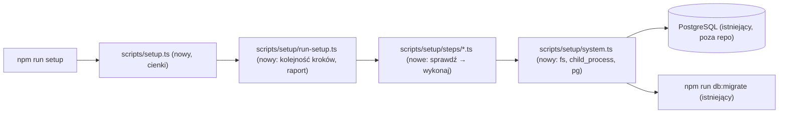

# Instalator `npm run setup`

- **Status:** zaakceptowana 2026-10-18 — decyzje 1–4 od właścicielki projektu ([#5](https://github.com/natalia-hanula/devmentor/issues/5)); decyzje wykonawcze A1–A9 zatwierdzone przez właścicielkę ([#6](https://github.com/natalia-hanula/devmentor/pull/6#issuecomment-6248813584)).
- **Issue:** [#5](https://github.com/natalia-hanula/devmentor/issues/5)

## 📝 TLDR

Dziś osoba, która klonuje DevMentora, przechodzi ręcznie cztery kroki z README → „Uruchomienie lokalne”: zależności, baza, `.env` z symlinkiem i migracje. Propozycja: komenda `npm run setup` (`scripts/setup.ts`) wykona te kroki po kolei. Każdy krok najpierw sprawdza, czy jest już zrobiony, więc drugie uruchomienie niczego nie psuje. Instalator nie instaluje ani nie uruchamia PostgreSQL. Sprawdza tylko, czy baza odpowiada pod `DATABASE_URL`, a jeśli nie, wypisuje, co zrobić, i kończy się błędem.

## 📝 Problem Statement

- Kroki są rozproszone, a pominięcie jednego objawia się dopiero w działającej aplikacji. Brak symlinku `packages/app/.env` daje na `/admin` „Brak połączenia” (`.ai/lessons/2026-10-18-env-w-monorepo-next.md`).
- Wariant Docker tworzy `devmentor_integration` tylko na pustym wolumenie (`docker/postgres/init/01-integration-db.sql` wykonuje się raz). Przy starszym wolumenie baza testowa nie istnieje i nic tego nie sygnalizuje.
- Ponowne wykonanie ręcznych kroków nie jest bezpieczne: `cp .env.example .env` nadpisuje lokalną konfigurację, `ln -s` kończy się błędem, `CREATE ROLE` / `CREATE DATABASE` też.

## 📝 Proposed Solution

Pojedynczy skrypt TypeScript uruchamiany przez Node bez kompilacji (type stripping), bez zależności npm w module startowym, bo pierwszym krokiem jest dopiero `npm install`. Kroki wykonują się w tej kolejności, a każdy raportuje jeden z trzech stanów: `wykonano`, `pominięto` (już zrobione) albo `błąd`:

| # | Krok | Sprawdzenie „już zrobione” | Gdy nie da się wykonać |
|---|------|----------------------------|------------------------|
| 0 | Platforma | — | `win32` → komunikat z odesłaniem do ręcznych kroków README, kod 1 |
| 1 | Node.js ≥ 22.17 | — | komunikat z wymaganą wersją, kod 1 |
| 2 | `npm install` | zawsze wykonywany — npm sam jest idempotentny i na aktualnym drzewie nic nie zmienia (zob. A3) | błąd npm przekazany dalej, kod 1 |
| 3 | `.env` z `.env.example` | `.env` istnieje — **nigdy nie nadpisujemy** | — |
| 4 | Symlink `packages/app/.env → ../../.env` | `lstat`: ścieżka jest symlinkiem do `../../.env` (także „wiszącym”, bo `.env` powstaje w kroku 3) | ścieżka istnieje i jest czymś innym → ostrzeżenie, plik nietknięty, krok `pominięto` |
| 5 | Odczyt `DATABASE_URL` | — | brak lub nie `postgres(ql)://` → komunikat, kod 1 |
| 6 | PostgreSQL odpowiada | połączenie z bazą `postgres` (konserwacyjną) przez dane z `DATABASE_URL`, z jawnym limitem czasu (`CONNECT_TIMEOUT_MS = 5000`; domyślne `0` w `pg` czeka bez końca) | komunikat zależny od przyczyny (zob. Edge Cases), kod 1 |
| 7 | Bazy `<baza z DATABASE_URL>` i `devmentor_integration` (bez duplikatu, gdy to ta sama nazwa) | wiersz w `pg_database`; wyścig z drugim uruchomieniem (`42P04 duplicate_database`) też daje `pominięto` | brak uprawnienia `CREATEDB` → komunikat, kod 1 |
| 8 | Migracje `npm run db:migrate` | MikroORM sam pomija wykonane migracje | błąd przekazany dalej, kod 1 |
| 9 | Podsumowanie | — | — |

Na koniec instalator wypisuje tabelę stanów i podpowiedź `npm run dev`. Nie uruchamia serwera.

`DATABASE_URL` jest odczytywany z tą samą precedencją co `packages/db/mikro-orm.config.ts`: najpierw `process.env.DATABASE_URL`, potem główny `.env`. Plik parsuje wbudowane `util.parseEnv` z Node, bez własnego parsera.

**Rozważone i odrzucone:**

- **Skrypt bash** (`scripts/setup.sh`): nie da się go pokryć testami Vitest (decyzja 2) i trudno go utrzymać na macOS i Linuksie.
- **Instalacja i start PostgreSQL przez instalator:** wykluczone decyzją 1, bo to zmiana systemu poza repo.
- **`psql` do tworzenia baz:** w wariancie Docker `psql` zwykle nie jest dostępny na hoście. Dodatkowo identyfikatory trzeba by wtedy sklejać w poleceniu powłoki.
- **Tworzenie baz przez `@devmentor/db` (MikroORM):** Node nie załaduje źródeł pakietu, które używają importów bez rozszerzeń, a `scripts/` nie może iść przez build Next.

## 📝 Architecture

Logika kroków nie dotyka systemu bezpośrednio. Dostaje obiekt `SetupSystem` (wejście/wyjście plików, uruchamianie komend, połączenie z bazą, wypisywanie), który w testach jednostkowych jest atrapą. `system.ts` to jedyne miejsce z `node:fs`, `node:child_process` i `pg`. `pg` jest ładowane dynamicznym importem dopiero po kroku 2, bo przed `npm install` może jeszcze nie istnieć.

Repo dostaje drugie miejsce z kodem TS poza `packages/`. Dlatego:

- `vitest.config.ts`: `coverage.include` + `"scripts/setup.ts"` i `"scripts/setup/**/*.ts"` (decyzja 2 — kod instalatora, bez plików testów z `scripts/test/`) i nowy projekt `scripts/vitest.config.ts` (`defineProject`, `name: "scripts"`, `include: ["test/**/*.test.ts"]`) dopisany do `projects`;
- `scripts/tsconfig.json` (nowy, `extends: ../tsconfig.base.json`): `allowImportingTsExtensions`, `erasableSyntaxOnly` i `verbatimModuleSyntax: true` — type stripping wymaga jawnych rozszerzeń `.ts`, zabrania `enum` / `namespace` i usuwa wyłącznie importy oznaczone `import type` (bazowe `verbatimModuleSyntax: false` przepuściłoby importy samych typów, które w Node kończą się błędem „does not provide an export named”). Osobny plik, żeby nie zmieniać ustawień pakietów i testów integracyjnych; skrypt `typecheck` w głównym `package.json` dostaje `tsc -p scripts`;
- `AGENTS.md` → „Testy i CI”: opis zakresu pokrycia rozszerzony o `scripts/**`;
- ESLint obejmuje `scripts/` już teraz (globalna konfiguracja). Wyjście instalatora to jego interfejs użytkownika, więc idzie przez `system.write()` (`process.stdout.write`), a nie przez `console.log` ani pino.

Konsumenci: nikt w kodzie aplikacji. `scripts/` nie jest importowany przez żaden pakiet i nie importuje żadnego pakietu wewnętrznego.

## 📝 Data Model

Bez zmian schematu. Instalator tworzy tylko bazy, nie tabele: tabele tworzą istniejące migracje. Nazwa bazy z `DATABASE_URL` przed użyciem w `CREATE DATABASE` jest walidowana wzorcem `^[a-z_][a-z0-9_]*$` i cytowana przez `client.escapeIdentifier()` z `pg`. `CREATE DATABASE` nie przyjmuje parametrów, więc to jedyne miejsce, gdzie identyfikator trafia do SQL. Sprawdzenie istnienia idzie zapytaniem z parametrem (`SELECT 1 FROM pg_database WHERE datname = $1`). To odstępstwo od reguły „zapytania tylko przez MikroORM” — zob. A9.

## 📝 API Contracts

Jedyny nowy kontrakt to skrypt npm:

- `npm run setup` → `node --experimental-strip-types scripts/setup.ts`. Bez argumentów.
- Kod wyjścia: `0`, gdy wszystkie kroki mają stan `wykonano` / `pominięto`; `1`, gdy którykolwiek ma `błąd`. Po pierwszym błędzie kolejne kroki się nie wykonują.
- Wyjście: jedna linia na krok (`✓ wykonano`, `– pominięto`, `✗ błąd`) z krótkim powodem, a na końcu podsumowanie. Wartości `DATABASE_URL` nie wypisujemy (zawiera hasło). Pokazujemy najwyżej host, port i nazwę bazy.

## 📝 Edge Cases & Failure Scenarios

- **`.env` istnieje, ale nie ma `DATABASE_URL`:** krok 5 kończy się błędem z prośbą o uzupełnienie według `.env.example`. Instalator nie edytuje `.env`.
- **`packages/app/.env` to zwykły plik albo symlink w inne miejsce:** ostrzeżenie z poleceniem naprawy, plik nietknięty. Krok kończy się stanem `pominięto` z ostrzeżeniem, bo Next może nadal działać z tym plikiem.
- **PostgreSQL nie działa / zły port / limit czasu** (`ECONNREFUSED`, `ETIMEDOUT`, przekroczony `CONNECT_TIMEOUT_MS`): „PostgreSQL nie odpowiada pod `host:port`” plus skrócone warianty A/B z README.
- **Złe hasło / brak roli** (`28P01`, `28000`): „PostgreSQL odpowiada, ale odrzuca rolę `rola`” plus polecenie utworzenia roli z README.
- **Brak bazy konserwacyjnej `postgres`** (`3D000`): komunikat z prośbą o utworzenie bazy ręcznie. Przy każdym z tych błędów: kod 1, a kroki 2–4 i tak są idempotentne.
- **Rola bez `CREATEDB` i brak bazy:** komunikat z poleceniem `ALTER ROLE … CREATEDB` albo utworzeniem bazy ręcznie.
- **Docker ze starym wolumenem bez `devmentor_integration`:** krok 7 tworzy brakującą bazę.
- **„Wiszący” symlink `packages/app/.env`** (np. `.env` usunięty): `existsSync` zwraca `false`, a `symlinkSync` rzuciłby `EEXIST` — dlatego krok 4 używa `lstat` i traktuje poprawny cel jako `pominięto`.
- **Dwa równoczesne uruchomienia:** `CREATE DATABASE` w jednym kończy się `42P04`, co krok 7 raportuje jako `pominięto`.
- **Nazwa bazy w `DATABASE_URL` zakodowana w URL** (`%5F`): ścieżka jest dekodowana `decodeURIComponent` przed walidacją.
- **Przerwanie w połowie (Ctrl+C, błąd):** każdy krok jest idempotentny, więc ponowne `npm run setup` dokończy pracę od miejsca przerwania. Instalator nie robi niczego, co wymagałoby wycofania.
- **Node < 22.6:** flaga `--experimental-strip-types` nie istnieje, więc Node kończy się błędem `bad option`, zanim zadziała krok 1. README podaje wymaganą wersję. Ten przypadek zostaje opisany, nie obsłużony.
- **Node 22.x:** Node wypisuje ostrzeżenie `ExperimentalWarning` o type stripping. To jest oczekiwane i nie jest błędem.
- **Brak sieci przy `npm install`:** błąd npm przekazany dalej, kod 1.

## 📝 Risks & Impact Review

- **Nowa zależność:** `pg` + `@types/pg` w głównych `devDependencies`. `pg` jest już w drzewie jako zależność `@mikro-orm/postgresql` (8.23.x), więc rozmiar `node_modules` się nie zmienia. Zgodnie z `AGENTS.md` instalujemy ją tam, gdzie się jej używa (root, bo `scripts/` należy do roota).
- **Zakres pokrycia** rośnie (`scripts/**`), a progi się nie zmieniają. To zaostrzenie reguły, zatwierdzone decyzją 2.
- **Kontrakty (`BACKWARD_COMPATIBILITY.md` §8):** nowy skrypt npm to zmiana niełamiąca. Ten sam PR aktualizuje README (opcja + tabela skryptów) i `AGENTS.md`.
- **Wycofanie:** usunięcie `scripts/`, wpisu `setup`, zależności `pg` i wpisów w konfiguracjach. Instalator nie zmienia niczego, czego ręczne kroki nie robią i tak.

## 📋 Phasing

Jedna faza, bo instalator jest użyteczny dopiero w całości. Każdy krok planu zostawia jednak repo w stanie zielonym.

## 📋 Implementation Plan

1. **Szkielet i narzędzia.** Dodać `scripts/vitest.config.ts`, wpis w `projects` i `coverage.include` w `vitest.config.ts`, `include` / `allowImportingTsExtensions` / `erasableSyntaxOnly` w głównym `tsconfig.json`, `pg` + `@types/pg` w `devDependencies`. Dodać typ `SetupSystem` i `run-setup.ts` z kolejnością kroków, raportem i kodem wyjścia oraz testy na atrapie systemu: kolejność, zatrzymanie po błędzie, podsumowanie. *Weryfikacja:* `npm run lint`, `npm run typecheck`, `npm test` (100%).
2. **Kroki plikowe i wymagania (0–4).** Platforma, wersja Node (stała `MIN_NODE_VERSION = "22.17.0"` + test sprawdzający zgodność z `engines` w `package.json`), `npm install`, `.env`, symlink (`lstat`). Testy: każdy krok w stanie „nie zrobione” → `wykonano`, „zrobione” → `pominięto`, oraz przypadki brzegowe (zwykły plik zamiast symlinku, wiszący symlink, `win32`, stary Node).
3. **Kroki bazodanowe (5–8).** Odczyt `DATABASE_URL` (env → `.env` przez `util.parseEnv`), połączenie z bazą `postgres` z limitem czasu, tworzenie brakujących baz, `npm run db:migrate`. Testy jednostkowe na atrapie klienta: każda klasa błędu połączenia z osobnym komunikatem, brak `CREATEDB`, baza istnieje / nie istnieje / `42P04`, baza główna o nazwie `devmentor_integration`, nieprawidłowa i zakodowana nazwa bazy, brak wypisywania hasła.
4. **Adapter systemowy i wejście.** `system.ts` (fs, `spawn` z dziedziczeniem stdio, dynamiczny import `pg`) i `scripts/setup.ts`. Testy z `vi.mock` modułów `node:*` i `pg`, tak aby oba pliki miały 100% pokrycia. Wpis `"setup"` w `package.json`.
5. **Test integracyjny.** `tests/integration/setup-databases.int.test.ts`: krok tworzenia baz na bazie z testcontainers. Unikalna nazwa bazy, pierwsze wywołanie → `wykonano`, drugie → `pominięto`, na koniec sprzątanie (`DROP DATABASE`).
6. **Dokumentacja.** `AGENTS.md` → „Baza danych”: wyjątek dla instalatora (zatwierdzony — zob. A9). README → „Uruchomienie lokalne”: najpierw „Szybko: `npm run setup`” (wymagania: Node, działający PostgreSQL), potem dotychczasowe kroki 1–4 jako „Ręcznie”. Do tego wiersz w „Dostępne skrypty” i `AGENTS.md` → zakres pokrycia. *Weryfikacja ręczna:* świeży klon + Docker → `npm run setup` → `npm run dev` → `/admin` „połączono”; drugie `npm run setup` → `.env`, symlink i bazy `pominięto`, `npm install` i migracje bez zmian.

## Kryteria akceptacji

- [x] Na świeżym klonie z działającym PostgreSQL `npm run setup`, a potem `npm run dev` daje działające `/admin` ze stanem połączenia. (Sprawdzone na świeżym worktree z PostgreSQL z Homebrew: `next dev` czyta `.env` przez symlink, a `/api/health`, z którego `/admin` pokazuje stan połączenia, zwraca `ok: true`. Wariantu Docker nie sprawdzałam lokalnie.)
- [x] Drugie uruchomienie kończy się kodem 0, kroki 3, 4 i 7 mają stan `pominięto`, `npm install` i migracje nic nie zmieniają, a `.env` jest bajt w bajt taki sam.
- [x] Istniejący `packages/app/.env`, który nie jest symlinkiem do `../../.env`, zostaje nietknięty i jest ostrzeżenie.
- [x] Gdy PostgreSQL nie odpowiada: kod 1 i instrukcja ręczna. Instalator nie uruchamia `brew` ani `docker`.
- [x] Brakująca `devmentor_integration` przy istniejącej bazie głównej zostaje utworzona.
- [x] `win32` → odesłanie do ręcznych kroków, kod 1.
- [x] `npm test` ma 100% pokrycia z `scripts/**` w zakresie. `npm run test:integration` zawiera test tworzenia baz.
- [x] README opisuje obie ścieżki. `AGENTS.md` opisuje nowy zakres pokrycia.

## Poza zakresem

Instalacja Node.js, Dockera, Homebrew i PostgreSQL; tworzenie ról; uruchamianie serwera; dane inne niż te z migracji; Windows; konfiguracja produkcyjna i CI; zmiana treści ręcznych kroków.

## Resolved assumptions (autonomous defaults)

Decyzje 1–4 z [komentarza właścicielki](https://github.com/natalia-hanula/devmentor/issues/5#issuecomment-6248703980) są wiążące. Poniższe decyzje wykonawcze przyjęłam domyślnie, a właścicielka zatwierdziła je 2026-10-18 ([#6](https://github.com/natalia-hanula/devmentor/pull/6#issuecomment-6248813584)), łącznie z tym, że `npm install` i migracje wykonują się przy każdym uruchomieniu:

| # | Pytanie | Przyjęta odpowiedź | Uzasadnienie |
|---|---------|--------------------|--------------|
| A1 | Jak uruchomić `.ts` na Node 22.17? | `node --experimental-strip-types`, bez zmiany `engines` | Flaga działa od 22.6 i jest akceptowana na 24.x. Podniesienie minimalnej wersji Node to osobna decyzja. |
| A2 | Klient PostgreSQL? | `pg` + `@types/pg` w głównych `devDependencies`, dynamiczny import po `npm install` | Działa w obu wariantach bazy, parametryzuje zapytania i cytuje identyfikatory. Jest już w drzewie zależności. |
| A3 | Kiedy pominąć `npm install`? | nigdy — zawsze `npm install` | npm jest idempotentny. `npm ls` sprawdza zakresy z `package.json`, a nie `package-lock.json`, więc po `git pull` z nowym lockiem pominąłby potrzebną instalację. Odstępstwo od literalnego „pomijania”: krok raportuje wynik npm zamiast `pominięto`. |
| A4 | Jak raportować migracje? | zawsze `npm run db:migrate`, wynik z MikroORM | MikroORM sam pomija wykonane migracje. Własne porównywanie z tabelą migracji wiązałoby skrypt z wewnętrznymi szczegółami ORM. |
| A5 | Nazwa bazy testowej? | stała `devmentor_integration`, a baza główna z `DATABASE_URL` | Ta sama nazwa jest w README, `.env.example` i `docker/postgres/init`. |
| A6 | Gdzie wypisywać komunikaty? | wstrzykiwany `write()` → `process.stdout` | To interfejs CLI, a nie log aplikacji. `console.log` jest zakazany, a pino w CLI nie ma sensu. |
| A7 | Gdzie testy? | `scripts/test/**/*.test.ts`, projekt Vitest `scripts` | Ta sama konwencja co `packages/<pakiet>/test/`. |
| A8 | Rozdzielić spec? | nie | To jedna zdolność, której części osobno nie działają. |
| A9 | Surowy SQL przez `pg` w `scripts/` mimo reguł `AGENTS.md` („wszystkie zapytania przez API encji/QueryBuilder MikroORM”, „tylko `db` importuje `@mikro-orm/*`”) | dopuścić jako jawny wyjątek tylko dla instalatora: `SELECT … WHERE datname = $1` z parametrem i `CREATE DATABASE` z identyfikatorem walidowanym i cytowanym przez `escapeIdentifier`; wyjątek dopisany do `AGENTS.md` → „Baza danych” w tym samym PR-ze. **✅ zatwierdzone 2026-10-18** | `CREATE DATABASE` nie ma odpowiednika w API encji MikroORM, a `scripts/` nie może importować źródeł `@devmentor/db` pod type stripping (importy bez rozszerzeń). Alternatywa — funkcja w `packages/db` uruchamiana przez loader CLI MikroORM — jest niesprawdzona i komplikuje instalator. Odstępstwo od wiążącej reguły zatwierdziła właścicielka projektu. |
